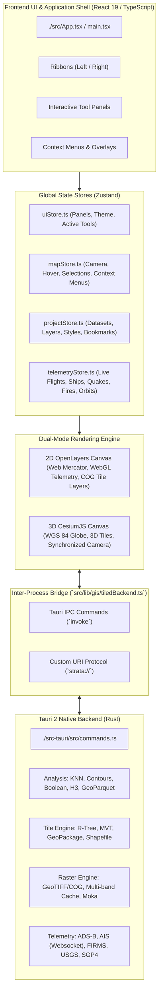

# Strata Codebase Scripts & Source Inventory

> **Comprehensive Reference & Technical Manifest**  
> **Application:** Strata Desktop GIS & Geospatial Intelligence Workspace  
> **Frameworks:** Tauri 2 (Rust) · React 19 · Vite 8 · OpenLayers 10 · CesiumJS · Zustand · Tailwind CSS 4 · Bun  
> **Scope:** Full inventory of all 200 source scripts, backend modules, UI components, domain engines, data pipelines, test suites, and configuration files.

---

## Table of Contents

1. [Architectural Overview & Subsystem Map](#1-architectural-overview--subsystem-map)
2. [Master Script List (All 200 Scripts & What They Do)](#2-master-script-list-all-200-scripts--what-they-do)
   - [2.1 Project Root, Build & Environment Scripts (10 files)](#21-project-root-build--environment-scripts-10-files)
   - [2.2 Automation & Data Pipeline Scripts (`./scripts/`, 3 files)](#22-automation--data-pipeline-scripts-scripts-3-files)
   - [2.3 Tauri Native Backend & Rust Engine (`./src-tauri/`, 37 files)](#23-tauri-native-backend--rust-engine-src-tauri-37-files)
   - [2.4 Frontend Application Core & Entry (`./src/`, 6 files)](#24-frontend-application-core--entry-src-6-files)
   - [2.5 Global State Management Stores (`./src/state/`, 7 files)](#25-global-state-management-stores-srcstate-7-files)
   - [2.6 Map & Dual-Rendering Subsystems (`./src/map/`, 10 files)](#26-map--dual-rendering-subsystems-srcmap-10-files)
   - [2.7 UI Chrome, Ribbons & Overlays (`./src/components/`, 20 files)](#27-ui-chrome-ribbons--overlays-srccomponents-20-files)
   - [2.8 Interactive Feature Panels (`./src/components/panels/`, 21 files)](#28-interactive-feature-panels-srccomponentspanels-21-files)
   - [2.9 GIS Domain Engine & Math Utilities (`./src/lib/gis/`, 45 files)](#29-gis-domain-engine--math-utilities-srclibgis-45-files)
   - [2.10 Foundation Utilities, Storage & Context (`./src/lib/`, 11 files)](#210-foundation-utilities-storage--context-srclib-11-files)
   - [2.11 Technical Documentation & Architecture Audits (`./docs/`, 4 files)](#211-technical-documentation--architecture-audits-docs-4-files)
   - [2.12 Embedded Datasets & Local Data Fixtures (26 files)](#212-embedded-datasets--local-data-fixtures-26-files)
   - [2.13 Workspace Executable CLI & NPM Scripts (`package.json`)](#213-workspace-executable-cli--npm-scripts-packagejson)
3. [Codebase Statistics Summary](#3-codebase-statistics-summary)
4. [Deep-Dive Technical Reference](#4-deep-dive-technical-reference)
   - [Section 1: Root Configuration, Build & Environment Scripts](#3-section-1-root-configuration-build--environment-scripts)
   - [Section 2: Automation & Data Pipeline Scripts](#4-section-2-automation--data-pipeline-scripts-scripts)
   - [Section 3: Rust Desktop Core & Tauri Backend](#5-section-3-rust-desktop-core--tauri-backend-src-tauri)
   - [Section 4: Frontend Application Core & Entry](#6-section-4-frontend-application-core--entry-src)
   - [Section 5: Global State Management](#7-section-5-global-state-management-srcstate)
   - [Section 6: Map & Rendering Subsystems](#8-section-6-map--rendering-subsystems-srcmap)
   - [Section 7: UI Chrome, Overlays & Ribbons](#9-section-7-ui-chrome-overlays--ribbons-srccomponents)
   - [Section 8: Interactive Panels & Workspace Tools](#10-section-8-interactive-panels--workspace-tools-srccomponentspanels)
   - [Section 9: GIS Domain Engine & Math Utilities](#11-section-9-gis-domain-engine--math-utilities-srclibgis)
   - [Section 10: Foundation, Storage & Context Services](#12-section-10-application-foundation-storage--context-services-srclib)
   - [Section 11: Architecture & Research Documentation](#13-section-11-architecture--research-documentation-docs)
   - [Section 12: Embedded Datasets & Local Data Fixtures](#14-section-12-embedded-datasets--local-data-fixtures)
5. [Complete Alphabetical Master Index of All 200 Files](#15-complete-alphabetical-master-index-of-all-200-files)
6. [Verification & Test Suite Summary](#16-verification--test-suite-summary)

---

## 1. Architectural Overview & Subsystem Map

Strata is designed as a high-performance, hybrid desktop geospatial intelligence application. Compute-heavy operations (spatial indexing, out-of-core file streaming, binary parsing, raster slicing, and websocket telemetry) execute natively in compiled Rust via Tauri 2, while interactive visualization, data inspection, and UI controls run within a React 19 single-page application.

---

## 2. Master Script List (All 200 Scripts & What They Do)

Every single script, source module, and configuration file across the codebase is listed below with its location-prefixed path (`./...`) and its concrete runtime function:

### 2.1 Project Root, Build & Environment Scripts (10 files)
- **`./.env`** — **What it does:** Stores local developer API keys and secrets for external services (NASA FIRMS, Cesium Ion, Google Maps, TomTom, AISStream, OpenSky); loaded at boot by Rust and Vite.
- **`./.env.example`** — **What it does:** Template documentation file listing all environment variable keys required to run full mapping, terrain, and live situational feeds.
- **`./.gitignore`** — **What it does:** Specifies Git version control exclusion patterns to prevent build artifacts (`/target`, `/dist`), node dependencies, caches, and private `.env` tokens from being committed.
- **`./README.md`** — **What it does:** Master project documentation describing Strata's capabilities, supported geospatial file formats, quickstart commands, architecture layout, keyboard shortcuts, and data licensing.
- **`./cctv_assets/.gitkeep`** — **What it does:** Git placeholder maintaining the existence of the `cctv_assets/` directory used for local surveillance snapshot storage and caching.
- **`./datasets.toml`** — **What it does:** Declarative master manifest configuring metadata, bounding extents, default CRS, zoom thresholds, and file paths for built-in geospatial datasets.
- **`./index.html`** — **What it does:** Single-page application entrypoint HTML file hosting the `#root` container, application vector favicon (`/strata.svg`), and bootstrapping `src/main.tsx`.
- **`./package.json`** — **What it does:** Node/Bun project manifest declaring npm dependencies (React 19, OpenLayers 10, CesiumJS, Zustand, Tailwind 4), dev dependencies, and execution scripts.
- **`./tsconfig.json`** — **What it does:** TypeScript compiler configuration for application source code, setting strict type-checking, ES2022 target, and JSX compilation rules.
- **`./tsconfig.node.json`** — **What it does:** Secondary TypeScript compiler configuration enforcing Node.js ESM compilation rules for Vite configuration tooling.
- **`./vite.config.ts`** — **What it does:** Vite 8 build and development server configuration; configures Tailwind 4, copies CesiumJS static assets (`Assets`, `Workers`, `Widgets`), sets strict port 1420, and passes environment API keys.

### 2.2 Automation & Data Pipeline Scripts (`./scripts/`, 3 files)
- **`./scripts/build-cctv-fixture.mjs`** — **What it does:** Ingests municipal DOT traffic camera open data, computes 3D camera orientations, merges them with precalculated ground heights, and outputs `data/local/cctv-ground-heights/cameras.json`.
- **`./scripts/build-datasets.mjs`** — **What it does:** Data compilation pipeline that reads raw local vector sources, executes geometry simplification via `topojson-simplify`, and outputs compressed TopoJSON packages to `public/datasets/`.
- **`./scripts/source-data/bgd-adm2-districts.geojson`** — **What it does:** Authoritative unsimplified boundary geometries for Bangladesh's 64 districts carrying standard UN OCHA `ADM2_PCODE` keys used by the build pipeline.

### 2.3 Tauri Native Backend & Rust Engine (`./src-tauri/`, 37 files)
- **`./src-tauri/.gitignore`** — **What it does:** Git ignore rules excluding Cargo build artifacts (`target/`) and temporary Rust compiler files.
- **`./src-tauri/Cargo.toml`** — **What it does:** Rust package manifest declaring dependencies (`tauri`, `geo`, `rstar`, `fast-mvt`, `kiddo`, `h3o`, `parquet`, `rusqlite`, `sgp4`), build profiles, and LTO compiler optimizations.
- **`./src-tauri/build.rs`** — **What it does:** Tauri build script compiling IPC handlers, security capabilities, and asset manifests during `cargo build`.
- **`./src-tauri/capabilities/default.json`** — **What it does:** Tauri 2 security capability declaration granting native file reading, file writing, dialog popups, and external URL opener permissions.
- **`./src-tauri/datasets.toml`** — **What it does:** Desktop-bundled copy of the master dataset manifest enabling offline catalog discovery without network dependencies.
- **`./src-tauri/gen/schemas/acl-manifests.json`** — **What it does:** Auto-generated validation schema for registered Tauri Access Control List (ACL) manifests.
- **`./src-tauri/gen/schemas/capabilities.json`** — **What it does:** Auto-generated JSON schema for validating Tauri application capabilities.
- **`./src-tauri/gen/schemas/desktop-schema.json`** — **What it does:** Auto-generated schema defining desktop window parameters and constraints.
- **`./src-tauri/gen/schemas/linux-schema.json`** — **What it does:** Auto-generated schema defining Linux platform-specific WebKit2GTK window settings.
- **`./src-tauri/src/main.rs`** — **What it does:** Native desktop binary entrypoint that configures Windows console subsystem settings, loads environment variables via `dotenvy`, and launches `strata_lib::run()`.
- **`./src-tauri/src/lib.rs`** — **What it does:** Tauri application library entrypoint; sets Linux WebKit DMA-BUF safety flags, initializes thread-safe vector and raster stores, registers the custom `strata://` URI scheme protocol, and mounts IPC command handlers.
- **`./src-tauri/src/commands.rs`** — **What it does:** Central Tauri IPC command module exposing native Rust functions to the frontend (`load_file_layer`, `spatial_knn_query`, `generate_contours`, `polygon_boolean_operation`, `fetch_live_flights`, `fetch_live_vessels`, etc.).
- **`./src-tauri/src/manifest.rs`** — **What it does:** Deserializer and parser reading `datasets.toml` into strongly-typed dataset and layer definitions.
- **`./src-tauri/src/analysis/mod.rs`** — **What it does:** Analysis module aggregator exporting spatial computation submodules for boolean CSG, contours, GeoParquet, H3 indexing, KNN, and geodesic math.
- **`./src-tauri/src/analysis/knn.rs`** — **What it does:** High-performance 3D Kd-Tree spatial K-Nearest Neighbors engine projecting WGS 84 points to Earth-Centered, Earth-Fixed (ECEF) Cartesian coordinates via the `kiddo` crate.
- **`./src-tauri/src/analysis/contours.rs`** — **What it does:** Marching Squares contour isoline generator converting regular scalar elevation grids into GeoJSON MultiPolygon and MultiLineString contour features.
- **`./src-tauri/src/analysis/boolean.rs`** — **What it does:** Constructive Solid Geometry (CSG) 2D polygon boolean engine executing exact Intersection, Union, Difference, and Symmetric Difference operations via the `geo` crate.
- **`./src-tauri/src/analysis/tools.rs`** — **What it does:** Core geodesy engine calculating Karney geodesic distances, bearings, geodesic circular point/line buffers, and polygon centroids.
- **`./src-tauri/src/analysis/h3.rs`** — **What it does:** Uber H3 discrete global hexagonal grid indexer using `h3o` to compute hexagonal cell polygons and aggregate point densities.
- **`./src-tauri/src/analysis/geoparquet.rs`** — **What it does:** Native Apache Parquet reader extracting WKB geometry columns and columnar attributes out-of-core without loading entire files into memory.
- **`./src-tauri/src/raster/mod.rs`** — **What it does:** Cloud-Optimized GeoTIFF registry and byte-range handler reading TIFF IFD headers and tile directories on demand.
- **`./src-tauri/src/raster/cache.rs`** — **What it does:** In-memory asynchronous Moka LRU cache caching decoded raster tile chunks to avoid redundant disk and network I/O.
- **`./src-tauri/src/telemetry/mod.rs`** — **What it does:** Situational telemetry aggregator re-exporting ingestion modules for flights, ships, earthquakes, fires, satellites, SQLite history, and binary encoders.
- **`./src-tauri/src/telemetry/adsb.rs`** — **What it does:** Live ADS-B flight tracking client fetching transponder fixes, resolving ICAO country registrations, and maintaining aircraft flight breadcrumb trails.
- **`./src-tauri/src/telemetry/ais.rs`** — **What it does:** Real-time maritime vessel client maintaining an asynchronous RFC 6455 WebSocket connection to `aisstream.io` and decoding position and voyage messages.
- **`./src-tauri/src/telemetry/earthquakes.rs`** — **What it does:** USGS Earthquake Hazards Program client querying global seismic events, hypocenter depths, and Richter/Moment magnitudes.
- **`./src-tauri/src/telemetry/firms.rs`** — **What it does:** NASA FIRMS client ingesting active wildfire and thermal anomaly detections from MODIS and VIIRS satellite instruments.
- **`./src-tauri/src/telemetry/satellites.rs`** — **What it does:** SGP4 orbital mechanics propagator calculating real-time satellite positions and ground tracks from Two-Line Element (TLE) sets.
- **`./src-tauri/src/telemetry/db.rs`** — **What it does:** Embedded SQLite database engine recording historical vessel and aircraft fixes for temporal timeline replay in the TimeDock.
- **`./src-tauri/src/telemetry/binary.rs`** — **What it does:** High-throughput binary encoder packing live telemetry targets into contiguous 32-byte Float32Array structs for direct WebGL VBO streaming.
- **`./src-tauri/src/tiles/mod.rs`** — **What it does:** Tile serving module aggregator exporting R-Tree spatial stores, custom protocol responders, and file loaders.
- **`./src-tauri/src/tiles/protocol.rs`** — **What it does:** Asynchronous URI protocol handler responding to `strata://tiles/{dataset}/{z}/{x}/{y}.pbf` dynamic MVT requests and `strata://cog/...` HTTP Range byte slices.
- **`./src-tauri/src/tiles/store.rs`** — **What it does:** Thread-safe in-memory RStar R-Tree spatial indexing store caching loaded vector features in EPSG:3857 coordinates.
- **`./src-tauri/src/tiles/shapefile_reader.rs`** — **What it does:** Native ESRI Shapefile reader parsing binary `.shp` geometry shapes and `.dbf` attribute tables directly in Rust.
- **`./src-tauri/src/tiles/gpkg.rs`** — **What it does:** Native OGC GeoPackage reader querying SQLite tables and decoding standard binary WKB geometry blobs.
- **`./src-tauri/src/tiles/math.rs`** — **What it does:** Spherical Mercator mathematics converting WGS 84 coordinates to EPSG:3857 and computing Slippy tile bounding envelopes.
- **`./src-tauri/tauri.conf.json`** — **What it does:** Primary configuration file defining application metadata, desktop window dimensions, security capabilities, and build command hooks.

### 2.4 Frontend Application Core & Entry (`./src/`, 6 files)
- **`./src/main.tsx`** — **What it does:** React application bootstrap entrypoint mounting `<App />` within the HTML root DOM element.
- **`./src/App.tsx`** — **What it does:** Top-level layout orchestrator and viewport coordinator; manages 2D/3D dual-canvas toggling, camera pose handoffs, ribbons, command bar, bottom docks, and global keyboard shortcuts (`D`, `L`, `T`, `M`, `0`, `+`, `-`, `Esc`).
- **`./src/index.css`** — **What it does:** Global stylesheet defining Tailwind CSS 4 directives, CSS-variable design tokens, light/dark theme variables, and typography rules.
- **`./src/vite-env.d.ts`** — **What it does:** Ambient TypeScript type declarations for Vite environment variables (`import.meta.env`).
- **`./src/types/vendor.d.ts`** — **What it does:** Ambient TypeScript declaration file for third-party libraries lacking bundled types (such as `shpjs`).
- **`./src/assets/fonts/helvetica-now-display/stylesheet.css`** — **What it does:** Local `@font-face` stylesheet declaring Helvetica Now Display typography across 10 weights and styles.

### 2.5 Global State Management Stores (`./src/state/`, 7 files)
- **`./src/state/uiStore.ts`** — **What it does:** Zustand store managing active drawer panels, 2D vs 3D view mode, basemap choice, theme (`light`/`dark`), scale units, and localStorage persistence.
- **`./src/state/mapStore.ts`** — **What it does:** Zustand store tracking real-time camera coordinates, zoom, rotation, tilt, bounding extent, hover states, and measurement/bookmark context menu popups.
- **`./src/state/mapStore.test.ts`** — **What it does:** Unit test suite validating map store camera synchronization, measurement state, and context menu lifecycles.
- **`./src/state/projectStore.ts`** — **What it does:** Master GIS workspace Zustand store managing datasets, layer ordering, symbology styling, attribute filters, and project-tier bookmarks.
- **`./src/state/projectStore.types.ts`** — **What it does:** TypeScript interface and type definitions for project store models, layer records, and actions.
- **`./src/state/projectStore.test.ts`** — **What it does:** Unit test suite validating dataset creation, strict layer reordering, reprojection, and cascaded deletions.
- **`./src/state/telemetryStore.ts`** — **What it does:** Real-time Zustand store managing active flight, vessel, earthquake, fire, and satellite target feeds, historical scrubbing, and provider health.

### 2.6 Map & Dual-Rendering Subsystems (`./src/map/`, 10 files)
- **`./src/map/MapCanvas.tsx`** — **What it does:** 2D map viewport component mounting the OpenLayers canvas within the React application layout.
- **`./src/map/CesiumCanvas.tsx`** — **What it does:** 3D virtual globe component mounting the CesiumJS viewer and handling 3D user interactions.
- **`./src/map/mapController.ts`** — **What it does:** Imperative OpenLayers controller managing basemap layers, vector sources, feature styling, hit-testing, and camera controls.
- **`./src/map/cesiumView.ts`** — **What it does:** Imperative CesiumJS controller managing globe imagery providers, 3D terrain, camera orientation sync, and 3D photorealistic tiles.
- **`./src/map/projections.ts`** — **What it does:** OpenLayers-to-Proj4 projection bridge listening to CRS registration events and declaring new coordinate systems at runtime.
- **`./src/map/vectorStyle.ts`** — **What it does:** Dynamic OpenLayers vector style generator compiling Strata layer symbology into point, stroke, and fill styles.
- **`./src/map/rasterLayer.ts`** — **What it does:** Cloud-Optimized GeoTIFF layer builder generating WebGL fragment shader band math (NDVI, NDWI, NDBI, NBR) and client-side pixel probes.
- **`./src/map/rasterLayer.test.ts`** — **What it does:** Unit tests validating strict `strata://cog` URL enforcement, divide-by-zero shader guards, and pixel probe calculations.
- **`./src/map/telemetryIcons.ts`** — **What it does:** Procedural SVG icon factory generating heading-rotated symbols for aircraft, maritime vessels, earthquakes, and satellites.
- **`./src/map/webglTelemetry.ts`** — **What it does:** High-speed WebGL point rendering layer consuming native binary buffers to display tens of thousands of telemetry targets at 60 FPS.

### 2.7 UI Chrome, Ribbons & Overlays (`./src/components/`, 20 files)
- **`./src/components/CommandBar.tsx`** — **What it does:** Top application header displaying project name, dirty status, telemetry feed toggles with active counters, and search trigger.
- **`./src/components/StatusBar.tsx`** — **What it does:** Bottom application status bar displaying live cursor coordinates (Decimal, DMS, MGRS), active CRS, zoom level, and service health.
- **`./src/components/StatusDot.tsx`** — **What it does:** Reusable visual status indicator pill (online, degraded, offline, active).
- **`./src/components/AlertQueue.tsx`** — **What it does:** High-priority notification drawer aggregating urgent seismic warnings, thermal anomalies, and emergency aircraft squawks.
- **`./src/components/FeaturePopup.tsx`** — **What it does:** Interactive click-card anchored to map coordinates displaying feature properties, copy actions, and embedded CCTV live video feeds.
- **`./src/components/TelemetryHoverPopup.tsx`** — **What it does:** Real-time floating tooltip displaying live flight, vessel, earthquake, and fire telemetry under the mouse cursor.
- **`./src/components/FloatingCanvasControls.tsx`** — **What it does:** On-canvas floating toolbar with zoom buttons, interactive compass rose, 2D/3D toggle, basemap dock, GPS button, and screenshot snip.
- **`./src/components/RegionSnipOverlay.tsx`** — **What it does:** Interactive rectangular crop marquee tool capturing and exporting high-resolution map canvas screenshots.
- **`./src/components/MapAttribution.tsx`** — **What it does:** Legal cartographic attribution bar displaying required copyright notices and external licensing links.
- **`./src/components/MeasureContextMenu.tsx`** — **What it does:** Context menu for drawn measurements showing perimeter/area and providing WKT/GeoJSON export and buffer tools.
- **`./src/components/BookmarkContextMenu.tsx`** — **What it does:** Interactive context menu for map bookmarks supporting priority changes, storage tier switching, and coordinate snapping.
- **`./src/components/BookmarkContextMenu.test.ts`** — **What it does:** Unit test suite verifying bookmark context menu actions and store updates.
- **`./src/components/PanelHost.tsx`** — **What it does:** Slide-out drawer container dynamically rendering the active tool panel based on UI state.
- **`./src/components/PanelShell.tsx`** — **What it does:** Standardized UI frame component providing consistent headers, icons, titles, and close buttons across all panels.
- **`./src/components/ProjectPlaque.tsx`** — **What it does:** Workspace summary widget displaying total loaded feature, dataset, and layer counts.
- **`./src/components/Toast.tsx`** — **What it does:** Temporary notification banner component displaying system messages and errors.
- **`./src/components/Kbd.tsx`** — **What it does:** Styled badge component for keyboard shortcuts in menus and tooltips.
- **`./src/components/ribbons/LeftRibbon.tsx`** — **What it does:** Left vertical navigation ribbon hosting buttons for Datasets, Bookmarks, Live Feeds, Search, and Settings.
- **`./src/components/ribbons/RightRibbon.tsx`** — **What it does:** Right vertical analysis ribbon hosting tools for Attribute Table, Measure, Elevation, KNN, Buffer, Boolean, and Join.
- **`./src/components/analysis/ElevationChart.tsx`** — **What it does:** Interactive SVG elevation profile cross-section chart displaying terrain slope, elevation gain, and interactive position scrubbers.

### 2.8 Interactive Feature Panels (`./src/components/panels/`, 21 files)
- **`./src/components/panels/DatasetsPanel.tsx`** — **What it does:** Master geospatial data catalog panel for file imports (GeoJSON, Shapefile, GPKG, Parquet, CSV), library products, and layer management.
- **`./src/components/panels/LayerPanel.tsx`** — **What it does:** Detailed layer configuration panel managing symbology colors, stroke widths, opacity, CRS reprojection, and multi-attribute facet filters.
- **`./src/components/panels/AttributesPanel.tsx`** — **What it does:** Windowed attribute data table with virtualized scrolling, column sorting, search, and feature highlight synchronization.
- **`./src/components/panels/FeaturePanel.tsx`** — **What it does:** Deep feature inspection panel displaying complete attribute sets, geometry metrics, Nominatim geocoding, and Wikipedia summaries.
- **`./src/components/panels/BasemapsPanel.tsx`** — **What it does:** Comprehensive basemap gallery panel for selecting vector styles and high-resolution satellite imagery services.
- **`./src/components/panels/HorizontalBasemapTray.tsx`** — **What it does:** Compact on-canvas floating dock for one-click basemap switching.
- **`./src/components/panels/BookmarksPanel.tsx`** — **What it does:** Spatial bookmark manager organizing locations into project-tier and personal user-tier storage with KML/GeoJSON/CSV export.
- **`./src/components/panels/BookmarksPanel.test.ts`** — **What it does:** Unit test suite validating bookmark CRUD operations, tier separation, and export formats.
- **`./src/components/panels/ElevationPanel.tsx`** — **What it does:** Terrain elevation profile and transect tool sampling elevations along drawn lines and rendering cross-section charts.
- **`./src/components/panels/MeasurePanel.tsx`** — **What it does:** Measurement panel module re-exporting `ElevationPanel` for distance, area, and elevation profiling workflows.
- **`./src/components/panels/KnnPanel.tsx`** — **What it does:** Interactive K-Nearest Neighbors query panel configuring search radii and executing native 3D Kd-Tree queries.
- **`./src/components/panels/BufferPanel.tsx`** — **What it does:** Geodesic buffer generation panel creating distance buffers around features and exporting them as new layers.
- **`./src/components/panels/BooleanPanel.tsx`** — **What it does:** Constructive Solid Geometry (CSG) polygon boolean panel executing 2D polygon intersection, union, and difference.
- **`./src/components/panels/JoinPanel.tsx`** — **What it does:** Tabular join wizard merging non-spatial CSV/TSV tables onto spatial boundary layers by matching shared keys.
- **`./src/components/panels/LiveFeedsSection.tsx`** — **What it does:** In-panel controller toggling live situational awareness feeds (ADS-B, AIS, earthquakes, fires, satellites).
- **`./src/components/panels/RasterDatasetsSection.tsx`** — **What it does:** In-panel controller managing Cloud-Optimized GeoTIFF layers, band math presets, and opacity.
- **`./src/components/panels/TimeDock.tsx`** — **What it does:** Historical temporal replay dock allowing time scrubbing across recorded flight and vessel telemetry.
- **`./src/components/panels/SearchPanel.tsx`** — **What it does:** Universal spatial search panel resolving layer attributes, coordinate strings (Decimal, DMS, MGRS), and OSM Nominatim places.
- **`./src/components/panels/ProjectPanel.tsx`** — **What it does:** Workspace project manager handling `.strata` project file creation, saving, loading, and recent project history.
- **`./src/components/panels/SettingsPanel.tsx`** — **What it does:** Preferences panel configuring theme modes, coordinate formats, measurement units, and listing registered CRS definitions.
- **`./src/components/panels/shared.tsx`** — **What it does:** Shared UI layout primitives and standardized Tailwind button/input class constants.

### 2.9 GIS Domain Engine & Math Utilities (`./src/lib/gis/`, 45 files)
- **`./src/lib/gis/types.ts`** — **What it does:** Authoritative domain TypeScript type definitions for geometries, features, layers, datasets, styles, camera, and basemaps.
- **`./src/lib/gis/data.ts`** — **What it does:** Static definitions for 9 standard vector/raster basemaps and bundled station network sample datasets.
- **`./src/lib/gis/crs.ts`** — **What it does:** Proj4-powered Coordinate Reference System registry and on-the-fly geometry reprojection engine supporting 140+ datums.
- **`./src/lib/gis/crs.test.ts`** — **What it does:** Unit tests verifying CRS string normalization, coordinate transformations, and domain boundary validation.
- **`./src/lib/gis/geometry.ts`** — **What it does:** Computational geometry library computing Karney geodesic distances, polygon surface areas, centroids, and bounding extents.
- **`./src/lib/gis/geometry.test.ts`** — **What it does:** Unit tests verifying geodesic distance, polygon area, and centroid computations across GeoJSON geometries.
- **`./src/lib/gis/analysis.test.ts`** — **What it does:** Unit tests validating compass azimuth conversions, geodesic transects, and line buffer expansion.
- **`./src/lib/gis/basemaps.test.ts`** — **What it does:** Unit tests verifying basemap endpoint configurations, tile sizing, and attribution requirements.
- **`./src/lib/gis/bookmarksIo.ts`** — **What it does:** Bookmark serialization codec exporting and importing spatial bookmarks across OGC KML 2.2, GeoJSON, and CSV formats.
- **`./src/lib/gis/bookmarksIo.test.ts`** — **What it does:** Unit tests verifying lossless round-tripping of bookmarks across KML, GeoJSON, and CSV.
- **`./src/lib/gis/cctv.ts`** — **What it does:** Traffic camera geometric model computing 3D sensor poses, monitor planes, ground heights, and 2D/3D viewshed cones.
- **`./src/lib/gis/cctv.test.ts`** — **What it does:** Unit tests verifying camera viewshed polygon generation and combined terrain elevation calculations.
- **`./src/lib/gis/csv.ts`** — **What it does:** Delimited text parser with automated delimiter sniffing, coordinate column detection, DMS decoding, and WKT parsing.
- **`./src/lib/gis/csv.test.ts`** — **What it does:** Unit tests verifying CSV/TSV delimiter detection, coordinate parsing, and layer CSV export.
- **`./src/lib/gis/datasets.ts`** — **What it does:** Dataset hierarchy engine enforcing grouping rules, layer reordering constraints, and unique name generation.
- **`./src/lib/gis/datasets.test.ts`** — **What it does:** Unit tests validating dataset grouping, layer ordering, and workspace restructuring logic.
- **`./src/lib/gis/filter.ts`** — **What it does:** Multi-attribute facet filtering engine evaluating compound Boolean AND/OR logic across feature properties.
- **`./src/lib/gis/filter.test.ts`** — **What it does:** Unit tests verifying attribute facet extraction and compound filter evaluation on vector layers.
- **`./src/lib/gis/geojson.ts`** — **What it does:** RFC 7946 GeoJSON parser and normalizer handling legacy CRS tags, ID de-duplication, and non-finite number filtering.
- **`./src/lib/gis/geojson.test.ts`** — **What it does:** Unit tests verifying GeoJSON validation, coordinate sanitization, and ID de-duplication.
- **`./src/lib/gis/geolocation.ts`** — **What it does:** Multi-tier geolocation resolver querying HTML5 GPS with automatic fallback to IP geolocation APIs (`ipwho.is`, `geojs.io`).
- **`./src/lib/gis/geolocation.test.ts`** — **What it does:** Unit tests verifying GPS and IP geolocation fallback resolution.
- **`./src/lib/gis/gpkg.ts`** — **What it does:** Client-side OGC GeoPackage reader querying SQLite databases and decoding binary geometries via lazy-loaded SQLite WASM (`sql.js`).
- **`./src/lib/gis/gpkg.test.ts`** — **What it does:** Unit tests verifying SQLite WASM GeoPackage database introspection and layer extraction.
- **`./src/lib/gis/join.ts`** — **What it does:** Attribute join engine matching non-spatial tabular data onto geographic boundaries using case-insensitive normalized keys.
- **`./src/lib/gis/join.test.ts`** — **What it does:** Unit tests verifying join key normalization, match preview calculation, and decoupled layer generation.
- **`./src/lib/gis/layers.ts`** — **What it does:** Vector layer constructor analyzing feature collections, assigning default symbologies, and computing attribute field schemas.
- **`./src/lib/gis/layers.test.ts`** — **What it does:** Unit tests verifying vector layer creation, bounding extent calculations, and geometry type detection.
- **`./src/lib/gis/library.ts`** — **What it does:** Built-in TopoJSON boundary catalog registry managing on-demand fetching and decoding of pre-bundled boundaries.
- **`./src/lib/gis/library.test.ts`** — **What it does:** Unit tests validating library catalog definitions and TopoJSON asset paths.
- **`./src/lib/gis/mgrs.ts`** — **What it does:** Military Grid Reference System (MGRS) coordinate encoder and decoder converting between WGS 84 and alphanumeric grid strings.
- **`./src/lib/gis/ports.ts`** — **What it does:** Curated world seaport gazetteer containing hundreds of commercial seaports, UN/LOCODEs, and AIS destination aliases.
- **`./src/lib/gis/sample.ts`** — **What it does:** Initial workspace dataset factory seeding the default high-speed rail line and station network.
- **`./src/lib/gis/shapefile.ts`** — **What it does:** Client-side ESRI Shapefile reader extracting `.shp`, `.dbf`, and `.prj` from `.zip` archives or loose files via `shpjs`.
- **`./src/lib/gis/shapefile.test.ts`** — **What it does:** Unit tests verifying Shapefile component detection and zip archive extraction.
- **`./src/lib/gis/telemetry.test.ts`** — **What it does:** Comprehensive unit test suite verifying ADS-B, AIS, earthquake, and satellite telemetry parsing.
- **`./src/lib/gis/telemetryExtendedDb.ts`** — **What it does:** HexDB.io v2 intelligence client fetching real-time aircraft specifications, liveries, operator info, and airframe photos.
- **`./src/lib/gis/tiledBackend.ts`** — **What it does:** Type-safe IPC bridge wrapping native Tauri `invoke()` calls with browser fallback mocks for spatial analysis and telemetry.
- **`./src/lib/gis/tiledBackend.test.ts`** — **What it does:** Unit tests verifying Tauri IPC bridge environment detection and mock response generation.
- **`./src/lib/gis/voyageRoute.ts`** — **What it does:** Great-circle maritime voyage route estimator calculating geodesic trajectories, antimeridian arc splitting, and ETAs.
- **`./src/lib/gis/voyageRoute.test.ts`** — **What it does:** Unit tests verifying seaport resolution, antimeridian arc division, and voyage time/speed math.
- **`./src/lib/gis/wkb.ts`** — **What it does:** High-performance Well-Known Binary (WKB) geometry decoder extracting 2D/3D points, lines, and polygons from binary blobs.
- **`./src/lib/gis/wkb.test.ts`** — **What it does:** Unit tests verifying Little-Endian and Big-Endian WKB geometry decoding.
- **`./src/lib/gis/wkt.ts`** — **What it does:** Well-Known Text (WKT) parser and serializer converting between geometry objects and standard text representations.
- **`./src/lib/gis/wkt.test.ts`** — **What it does:** Unit tests verifying WKT parsing, geometry serialization, and syntax error handling.

### 2.10 Foundation Utilities, Storage & Context (`./src/lib/`, 11 files)
- **`./src/lib/cx.ts`** — **What it does:** Lightweight conditional CSS class name concatenation utility.
- **`./src/lib/fileIo.ts`** — **What it does:** Platform-agnostic file IO bridge switching between native Tauri dialogs/fs plugins and browser file inputs/downloads.
- **`./src/lib/format.ts`** — **What it does:** Coordinate and measurement formatter supporting Decimal degrees, DMS with 60-second rollover guards, MGRS, distances, and areas.
- **`./src/lib/format.test.ts`** — **What it does:** Unit tests verifying coordinate formatting, hemisphere suffixing, and 60-second overflow guards.
- **`./src/lib/mgrs.d.ts`** — **What it does:** TypeScript declaration file providing type definitions for the external `mgrs` library.
- **`./src/lib/openExternal.ts`** — **What it does:** Secure external URL opener using Tauri's native opener plugin in desktop mode or `window.open` in web mode.
- **`./src/lib/projectFile.ts`** — **What it does:** Project serializer and migration engine saving and restoring `.strata` workspace files with schema version upgrades.
- **`./src/lib/projectFile.test.ts`** — **What it does:** Unit tests validating project file serialization, custom projection persistence, and legacy schema upgrades.
- **`./src/lib/store/index.ts`** — **What it does:** Store module namespace aggregator.
- **`./src/lib/online/context.ts`** — **What it does:** Online geospatial context client querying OpenStreetMap Nominatim, Wikipedia REST summaries, and Overpass tags.
- **`./src/lib/online/context.test.ts`** — **What it does:** Unit tests validating Nominatim address formatting, Wikipedia title extraction, and Overpass query construction.

### 2.11 Technical Documentation & Architecture Audits (`./docs/`, 4 files)
- **`./docs/2D3D_AUDIT.md`** — **What it does:** Detailed technical audit evaluating seamless dual-engine 2D (OpenLayers) and 3D (CesiumJS) rendering and camera synchronization.
- **`./docs/3D_MAP_RESEARCH.md`** — **What it does:** Architecture research memo analyzing OpenLayers, CesiumJS, and ol-cesium for complete 2D/3D GIS feature parity.
- **`./docs/AI_RESEARCH.md`** — **What it does:** Strategic research document detailing Geospatial AI (GeoAI) integration, on-device LLMs, and automated telemetry analysis.
- **`./docs/UI_GOV_READINESS.md`** — **What it does:** Defense and government readiness audit evaluating dark-room cartography, C2 compliance, and air-gapped zero-leakage deployments.

### 2.12 Embedded Datasets & Local Data Fixtures (26 files)
- **`./public/strata.svg`** — **What it does:** Official application vector icon and favicon.
- **`./public/datasets/bgd-adm2.topo.json`** — **What it does:** Pre-packed Bangladesh 64 district boundaries for tabular join workflows.
- **`./public/datasets/cctv-cameras.topo.json`** — **What it does:** Pre-packed traffic camera coordinates and 3D viewshed cones.
- **`./public/datasets/dams.topo.json`** — **What it does:** Pre-packed global dam infrastructure footprint layer from OpenStreetMap.
- **`./public/datasets/datacenters.topo.json`** — **What it does:** Pre-packed global datacenter footprints layer from OpenStreetMap.
- **`./public/datasets/military-areas.topo.json`** — **What it does:** Pre-packed gazetteer of 36,466 global military installation label centroids.
- **`./public/datasets/submarine-cables.topo.json`** — **What it does:** Pre-packed international submarine fiber-optic cables and coastal landing points.
- **`./public/datasets/us-counties.topo.json`** — **What it does:** Pre-packed US Census Bureau county cartographic boundary pack (3,235 counties).
- **`./public/datasets/world-admin1.topo.json`** — **What it does:** Pre-packed Natural Earth 10m first-order administrative boundaries (4,589 units).
- **`./data/local/cctv-ground-heights/README.md`** — **What it does:** Documentation for precomputed traffic camera ground heights.
- **`./data/local/cctv-ground-heights/cameras.json`** — **What it does:** Catalog of traffic cameras with sensor orientations, stream URLs, and focal lengths.
- **`./data/local/cctv-ground-heights/cctv_ground_heights.json`** — **What it does:** Terrain ground elevation database keyed by camera identifier.
- **`./data/local/dams/README.md`** — **What it does:** Documentation and ODbL license notes for OpenStreetMap dam extractions.
- **`./data/local/dams/dams.geojsonl`** — **What it does:** Source GeoJSON lines file containing 704 global dam polygon geometries.
- **`./data/local/datacenters/README.md`** — **What it does:** Documentation and attribution for OpenStreetMap datacenter polygons.
- **`./data/local/datacenters/datacenters.geojsonl`** — **What it does:** Source GeoJSON lines file containing 4,351 global datacenter footprints.
- **`./data/local/osm_military_names/README.md`** — **What it does:** Documentation and schema notes for the 36,466 named military areas database.
- **`./data/local/osm_military_names/names.json`** — **What it does:** Source database of military area names, classifications, bounds, and surface areas.
- **`./data/local/osm_military_names/names.sha256`** — **What it does:** Cryptographic SHA-256 verification hash ensuring `names.json` data integrity.
- **`./data/local/telegeography_submarine_cables/README.md`** — **What it does:** License terms and attribution documentation for TeleGeography cable data.
- **`./data/local/telegeography_submarine_cables/cable-geo.json`** — **What it does:** GeoJSON linestrings for 712 international submarine cable routes.
- **`./data/local/telegeography_submarine_cables/landing-point-geo.json`** — **What it does:** GeoJSON points for 1,917 coastal submarine cable landing stations.
- **`./data/local/telegeography_submarine_cables/source.json`** — **What it does:** Source metadata and timestamp references for TeleGeography datasets.
- **`./data/local/us_census_counties/README.md`** — **What it does:** Documentation and public domain attribution for US Census county boundaries.
- **`./data/local/us_census_counties/counties.json`** — **What it does:** Source cartographic polygon outlines for all 3,235 US counties.

### 2.13 Workspace Executable CLI & NPM Scripts (`package.json`)
- **`bun run dev`** — Starts the local Vite development web server on `http://localhost:1420` with Hot Module Replacement (HMR).
- **`bun run tauri dev`** — Spawns the native desktop application window with live Rust and frontend hot reloading.
- **`bun run build`** — Executes TypeScript type-checking (`tsc`) and compiles the production web bundle via Vite into `dist/`.
- **`bun run preview`** — Starts a local HTTP server serving the compiled production bundle for pre-release verification.
- **`bun test`** — Runs all 278 automated unit tests across 29 test suites in `bun:test`.
- **`node scripts/build-datasets.mjs`** — Rebuilds and compresses all bundled TopoJSON boundary packs from local source geometries.
- **`node scripts/build-cctv-fixture.mjs`** — Rebuilds traffic camera fixtures with 3D viewsheds and ground height matrices.

---

## 3. Codebase Statistics Summary

| Category | File Count | Primary Technologies |
| :--- | :--- | :--- |
| **Root & Build Configurations** | 10 files | TypeScript, Vite, Tailwind CSS 4, Bun, TOML, HTML |
| **Automation & Data Pipelines** | 3 files | Node.js (ESM), TopoJSON, GeoJSON |
| **Tauri Desktop Backend (Rust)** | 37 files | Rust (edition 2024), Tauri 2, Geo, RStar, Fast-MVT, Kiddo, SGP4, Rusqlite |
| **Frontend Application Core** | 6 files | TypeScript, React 19, CSS tokens |
| **Zustand State Stores** | 7 files | TypeScript, Zustand, Bun Test |
| **Map & Rendering Engines** | 10 files | OpenLayers 10, CesiumJS, WebGL shaders, Proj4 |
| **UI Components, Chrome & Ribbons** | 20 files | React 19, Lucide React, Tailwind CSS |
| **Interactive Feature Panels** | 21 files | React 19, HTML forms, windowed tables |
| **GIS Domain Engine & Drivers** | 45 files | TypeScript, Proj4, TopoJSON, SQL.js (WASM), ShpJS, GeoJSON |
| **Core Utilities & Storage** | 11 files | TypeScript, Tauri FS/Dialog plugins, Overpass/Nominatim APIs |
| **Research & Architecture Audits** | 4 files | Markdown |
| **Data Fixtures & Public Datasets** | 26 files | TopoJSON, GeoJSONL, JSON, Markdown |
| **Total Files Cataloged** | **200 files** | **278 Passing Unit Tests** |

---

## 4. Deep-Dive Technical Reference

## 3. Section 1: Root Configuration, Build & Environment Scripts

### `./README.md`
- **Language / Format:** Markdown
- **Primary Purpose:** Project manifesto, capability showcase, and technical quickstart guide.
- **Key Use Cases:**
  - Documents core GIS capabilities: dataset formats (GeoJSON, CSV, WKT, Shapefiles, GeoPackages), TopoJSON libraries, basemaps, CRS reprojection, spatial analysis, and project files.
  - Specifies local setup commands (`bun install`, `bun run dev`, `bun run tauri dev`, `bun test`).
  - Lists bundled boundary packs, geographic coordinate domains, and licensing constraints (e.g. TeleGeography non-commercial terms).
- **Connected Subsystems:** Project documentation, onboarding, developer workflow.

### `./package.json`
- **Language / Format:** JSON
- **Primary Purpose:** Node.js / Bun project manifest, scripts registry, and dependency specifications.
- **Key Use Cases:**
  - Declares workspace scripts: `dev` (Vite dev server on port 1420), `build` (TypeScript typecheck + Vite build), `preview` (Vite preview), `test` (Bun test runner), and `tauri` (Tauri CLI wrapper).
  - Specifies production dependencies: React 19, OpenLayers 10, CesiumJS 1.146, Zustand 5, Tailwind CSS 4, Proj4, TopoJSON, ShpJS, SQL.js, and Lucide icons.
  - Specifies dev dependencies: `@tauri-apps/cli`, Vite plugins, TypeScript 7, and TopoJSON build tools.
- **Connected Subsystems:** Bun runtime, Vite bundler, Tauri build system.

### `./vite.config.ts`
- **Language / Format:** TypeScript
- **Primary Purpose:** Vite 8 build and development server configuration tailored for Tauri 2 desktop integration.
- **Key Use Cases:**
  - Configures React plugin and Tailwind CSS 4 Vite plugin.
  - Copies Cesium static runtime assets (`Assets`, `Widgets`, `Workers`, `ThirdParty`) from `node_modules/cesium/Build/Cesium/` directly into `dist/cesium` using `vite-plugin-static-copy`.
  - Injects environment API keys at compile-time: `GOOGLE_MAPS_API_KEY`, `CESIUM_ION_TOKEN`, `TOMTOM_API_KEY`, `FIRMS_MAP_KEY`, `AISSTREAM_API_KEY`, and `OPENSKY_CLIENT_ID`.
  - Configures strict port `1420`, dev host resolution, WebSocket HMR, and instructs the file watcher to ignore `src-tauri` directory rebuild loops.
- **Connected Subsystems:** Vite dev server, CesiumJS runtime, Tauri desktop runner.

### `./tsconfig.json`
- **Language / Format:** JSON with Comments
- **Primary Purpose:** TypeScript compiler configuration for application source code.
- **Key Use Cases:**
  - Targets `ES2022` with strict type-checking enabled.
  - Configures module resolution (`bundler`) and JSX transform (`react-jsx`).
  - Pulls in type definitions for Bun test runner (`bun-types`), Vite client, and custom vendor declarations.
- **Connected Subsystems:** TypeScript typechecker (`tsc`), IDE language servers.

### `./tsconfig.node.json`
- **Language / Format:** JSON
- **Primary Purpose:** TypeScript compiler configuration for Node/Vite build tooling.
- **Key Use Cases:**
  - Compiles `vite.config.ts` and related build configuration files under module resolution rules suited for Node ESM.
- **Connected Subsystems:** Vite build pipeline.

### `./index.html`
- **Language / Format:** HTML5
- **Primary Purpose:** Single-page application entrypoint document.
- **Key Use Cases:**
  - Mounts the `#root` DOM element for React rendering.
  - Loads application favicon (`/strata.svg`) and typography stylesheets.
  - Bootstraps the JavaScript entry script (`/src/main.tsx`).
- **Connected Subsystems:** Browser DOM, React root mounting.

### `./datasets.toml`
- **Language / Format:** TOML
- **Primary Purpose:** Declarative geospatial dataset manifest for built-in and out-of-core GIS datasets.
- **Key Use Cases:**
  - Defines metadata, license, default CRS, zoom thresholds, and file paths for standard layers:
    - `cctv_cameras` (Traffic Cameras & Viewsheds)
    - `osm_datacenters` (OpenStreetMap Data Centers)
    - `submarine_cables` (Submarine Fiber Optic Cable Systems)
    - `osm_military` (Military Bases & Installation Names)
    - `osm_dams` (Major Dam & Water Infrastructure)
    - `us_counties` (US Census Bureau County Cartographic Boundaries)
    - `world_admin1` (Natural Earth 10m First-Order Administrative Divisions)
    - `bgd_adm2` (Bangladesh ADM2 District Boundaries)
- **Connected Subsystems:** Read by Rust backend manifest loader (`manifest.rs`) and frontend catalog (`DatasetsPanel.tsx`).

### `./.env.example`
- **Language / Format:** Configuration
- **Primary Purpose:** Template for required external API credentials and runtime secrets.
- **Key Use Cases:**
  - Documents variable keys for NASA FIRMS thermal anomaly maps (`FIRMS_MAP_KEY`), Cesium Ion 3D tiles (`CESIUM_ION_TOKEN`), Google Maps basemaps (`GOOGLE_MAPS_API_KEY`), TomTom live traffic (`TOMTOM_API_KEY`), and AISStream maritime tracking (`AISSTREAM_API_KEY`).
- **Connected Subsystems:** Environment variable loaders (`dotenvy` in Rust, `loadEnv` in Vite).

### `./.env`
- **Language / Format:** Configuration
- **Primary Purpose:** Local developer environment variable file containing actual API tokens and operational endpoints.
- **Key Use Cases:**
  - Supplies private keys for local development to unlock live ADS-B, AIS, FIRMS, and satellite telemetry feeds.
- **Connected Subsystems:** Ignored by Git; loaded at boot by `src-tauri/src/main.rs` and `vite.config.ts`.

### `./.gitignore`
- **Language / Format:** Plain Text
- **Primary Purpose:** Git version control exclusion rules.
- **Key Use Cases:**
  - Excludes `node_modules/`, `dist/`, `target/`, temporary caches, SQLite databases, and `.env` credentials from repository tracking.
- **Connected Subsystems:** Git version control.

### `./cctv_assets/.gitkeep`
- **Language / Format:** Git placeholder
- **Primary Purpose:** Preserves the `cctv_assets/` local directory in repository tracking for snapshot and media cache fixtures.
- **Key Use Cases:**
  - Ensures folder existence for storing downloaded or generated CCTV snapshot frames.
- **Connected Subsystems:** CCTV media pipeline.

---

## 4. Section 2: Automation & Data Pipeline Scripts (`./scripts/`)

### `./scripts/build-datasets.mjs`
- **Language / Format:** Node.js (ESM / JavaScript)
- **Primary Purpose:** Boundary data pipeline script that packs raw geographic source files into lightweight TopoJSON bundles.
- **Key Use Cases:**
  - Reads source geometries from `data/local/` and `scripts/source-data/`.
  - Runs geometry simplification and topology encoding via `topojson-server` and `topojson-simplify`.
  - Outputs compact TopoJSON archives to `public/datasets/`:
    - `world-admin1.topo.json` (4,589 global admin-1 units)
    - `bgd-adm2.topo.json` (64 Bangladesh districts)
    - `submarine-cables.topo.json` (cable lines and landing points)
    - `datacenters.topo.json` (datacenter footprints)
    - `dams.topo.json` (dam footprints)
    - `military-areas.topo.json` (36,466 military area label centroids)
    - `us-counties.topo.json` (3,235 US Census county boundaries)
  - Supports `--only local` flag to selectively repack local datasets without re-downloading external sources.
- **Connected Subsystems:** TopoJSON build pipeline, `src/lib/gis/library.ts`, `DatasetsPanel.tsx`.

### `./scripts/build-cctv-fixture.mjs`
- **Language / Format:** Node.js (ESM / JavaScript)
- **Primary Purpose:** Generator for static CCTV camera fixtures and terrain ground elevation mappings.
- **Key Use Cases:**
  - Ingests open-data traffic camera metadata from public DOT endpoints (coordinates, camera orientation, field-of-view, monitor bounding points).
  - Merges camera positions with precomputed ellipsoidal ground heights (`cctv_ground_heights.json`) aligned with 3D photorealistic tiles.
  - Writes normalized catalog fixture to `data/local/cctv-ground-heights/cameras.json`.
- **Connected Subsystems:** `data/local/cctv-ground-heights/`, `src/lib/gis/cctv.ts`, 3D viewshed rendering.

### `./scripts/source-data/bgd-adm2-districts.geojson`
- **Language / Format:** GeoJSON (RFC 7946)
- **Primary Purpose:** High-resolution unsimplified source boundaries for Bangladesh's 64 administrative districts.
- **Key Use Cases:**
  - Serves as the authoritative source geometry (originating from UN OCHA / BBS) containing standard `ADM2_PCODE` identifiers.
  - Processed by `build-datasets.mjs` to produce the simplified 0.5 MB `bgd-adm2.topo.json` bundle while preserving natural join keys.
- **Connected Subsystems:** `scripts/build-datasets.mjs`, `JoinPanel.tsx`.

---

## 5. Section 3: Rust Desktop Core & Tauri Backend (`./src-tauri/`)

### 3.1 Tauri Core, Manifests & Permissions

#### `./src-tauri/Cargo.toml`
- **Language / Format:** TOML
- **Primary Purpose:** Cargo manifest defining Rust dependencies, compiler profiles, and crate metadata.
- **Key Use Cases:**
  - Configures Rust 2024 edition crate `strata` (with `strata_lib` output).
  - Configures performance release profile: LTO (`lto = true`), single codegen unit (`codegen-units = 1`), `opt-level = 3`, and symbol stripping.
  - Defines native GIS dependencies: `geo` (algorithms), `rstar` (R-Tree spatial index), `fast-mvt` & `geozero` (vector tiles), `kiddo` (Kd-Tree), `h3o` (Uber H3), `contour` (marching squares), `parquet` (GeoParquet), `rusqlite` (bundled SQLite), `shapefile` (Shapefile reader), `jord` (geodesy), `sgp4` (satellite orbit propagator), and `moka` (concurrent cache).
- **Connected Subsystems:** Cargo build system, Tauri compiler.

#### `./src-tauri/build.rs`
- **Language / Format:** Rust
- **Primary Purpose:** Tauri build script.
- **Key Use Cases:**
  - Triggers `tauri_build::build()` to compile IPC bindings, security capabilities, and asset manifests.
- **Connected Subsystems:** Tauri build lifecycle.

#### `./src-tauri/tauri.conf.json`
- **Language / Format:** JSON
- **Primary Purpose:** Tauri 2 desktop runtime and window configuration.
- **Key Use Cases:**
  - Configures app metadata: name `Strata`, bundle identifier `com.nethan.strata`, version `0.1.0`.
  - Defines native desktop window properties (title, minimum dimensions, fullscreen toggles, transparent titlebar styling).
  - Configures devUrl (`http://localhost:1420`), frontend dist directory (`../dist`), and build hooks.
  - Registers security capabilities and permissions.
- **Connected Subsystems:** Tauri desktop window manager, native shell.

#### `./src-tauri/capabilities/default.json`
- **Language / Format:** JSON
- **Primary Purpose:** Security capability declaration for Tauri 2 application.
- **Key Use Cases:**
  - Grants permissions for native file system access (`fs:allow-read-text-file`, `fs:allow-write-text-file`), native file dialogs (`dialog:allow-open`, `dialog:allow-save`), and external browser URL opening (`opener:allow-open-url`).
- **Connected Subsystems:** Tauri IPC security permissions manager.

#### `./src-tauri/datasets.toml`
- **Language / Format:** TOML
- **Primary Purpose:** Embedded copy of the master dataset manifest bundled into the desktop release.
- **Key Use Cases:**
  - Enables offline native catalog discovery when running without external web assets.
- **Connected Subsystems:** `src-tauri/src/manifest.rs`.

#### `./src-tauri/.gitignore`
- **Language / Format:** Plain Text
- **Primary Purpose:** Rust/Cargo build artifact exclusions (`/target`, `*.rs.bk`).
- **Connected Subsystems:** Git version control.

#### Generated ACL & Capability Schemas (`./src-tauri/gen/schemas/`):
- `./src-tauri/gen/schemas/acl-manifests.json`: Auto-generated schema of registered Access Control List (ACL) manifests.
- `./src-tauri/gen/schemas/capabilities.json`: Auto-generated validation schema for Tauri 2 window capabilities.
- `./src-tauri/gen/schemas/desktop-schema.json`: JSON schema for desktop window configuration validation.
- `./src-tauri/gen/schemas/linux-schema.json`: Linux platform-specific configuration schema (Webkit2GTK settings).

---

### 3.2 Native IPC Commands Handler

#### `./src-tauri/src/main.rs`
- **Language / Format:** Rust
- **Primary Purpose:** Desktop executable entrypoint.
- **Key Use Cases:**
  - Disables console window popups on Windows in release mode (`windows_subsystem = "windows"`).
  - Bootstraps environment variables via `dotenvy::dotenv()`.
  - Invokes `strata_lib::run()` to launch the Tauri desktop application.
- **Connected Subsystems:** Desktop OS executable lifecycle.

#### `./src-tauri/src/lib.rs`
- **Language / Format:** Rust
- **Primary Purpose:** Library root, state store initialization, and custom protocol registration.
- **Key Use Cases:**
  - Linux WebKit GPU fix: sets `WEBKIT_DISABLE_DMABUF_RENDERER=1` at process boot to prevent WebKit2GTK DMA-BUF rendering crashes.
  - Initializes thread-safe shared state: `SharedDatasetStore` (R-Tree indexed vector datasets) and `SharedRasterRegistry` (GeoTIFF/COG sources).
  - Registers the custom asynchronous URI scheme protocol `strata://` for high-throughput tile and raster streaming (`strata://tiles/...` and `strata://cog/...`).
  - Registers all Tauri IPC command handlers across spatial analysis, telemetry, tile serving, and dataset inspection.
- **Connected Subsystems:** Tauri runtime, Webview protocol handler, React frontend bridge.

#### `./src-tauri/src/commands.rs`
- **Language / Format:** Rust
- **Primary Purpose:** Primary IPC command module exposing native Rust functions to the frontend.
- **Key Use Cases:**
  - **Vector Dataset Management:** `register_geojson_layer`, `load_file_layer`, `load_spatial_dataset_native`, `get_layer_records`, `remove_layer`, `has_layer`, `get_dataset_manifest`.
  - **Spatial Analysis:** `measure_geodesic`, `spatial_buffer_query`, `elevation_profile`, `compute_h3_aggregation`, `polygon_boolean_operation`, `generate_contours`, `spatial_knn_query`.
  - **GeoParquet Streaming:** `inspect_geoparquet`, `load_geoparquet_layer`.
  - **Telemetry Ingestion:** `fetch_live_flights`, `get_flight_trail`, `query_live_flights_binary`, `fetch_live_earthquakes`, `fetch_live_satellites`, `fetch_live_fires`, `fetch_live_vessels`, `get_api_providers_status`, `get_adsb_telemetry_status`, `fetch_telemetry_binary`.
  - **Raster / COG Presets:** `register_cog_layer`, `get_cog_presets`.
- **Connected Subsystems:** Invoked via `@tauri-apps/api/core` `invoke()` in `src/lib/gis/tiledBackend.ts`.

#### `./src-tauri/src/manifest.rs`
- **Language / Format:** Rust
- **Primary Purpose:** Parser and deserializer for `datasets.toml` manifests.
- **Key Use Cases:**
  - Maps TOML dataset configurations into strongly-typed Rust structures (`DatasetManifestEntry`, `DatasetSource`, `LayerDefinition`).
  - Provides manifest inspection commands to the frontend catalog.
- **Connected Subsystems:** `datasets.toml`, `commands::get_dataset_manifest`.

---

### 3.3 Spatial Analysis Engine (`./src-tauri/src/analysis/`)

#### `./src-tauri/src/analysis/mod.rs`
- **Language / Format:** Rust
- **Primary Purpose:** Module aggregator re-exporting all spatial analysis submodules.
- **Key Use Cases:**
  - Exports boolean geometry, contours, geoparquet, H3 indexing, KNN nearest-neighbor, and spatial distance measurement functions.
- **Connected Subsystems:** `commands.rs`.

#### `./src-tauri/src/analysis/knn.rs`
- **Language / Format:** Rust
- **Primary Purpose:** High-performance K-Nearest Neighbors (KNN) spatial search engine using 3D Kd-Trees.
- **Key Use Cases:**
  - Projects WGS 84 geographic coordinates `(lon, lat)` into Earth-Centered, Earth-Fixed (ECEF) 3D Cartesian coordinates `[x, y, z]` using WGS 84 ellipsoid parameters.
  - Builds immutable 3D Kd-Trees via the `kiddo` crate.
  - Performs nearest neighbor spatial queries returning top-K closest features, exact geodesic distances (in meters), bearings, and associated GeoJSON feature properties.
- **Connected Subsystems:** `commands::spatial_knn_query`, `KnnPanel.tsx`.

#### `./src-tauri/src/analysis/contours.rs`
- **Language / Format:** Rust
- **Primary Purpose:** Vector contour isoline generator.
- **Key Use Cases:**
  - Implements Marching Squares contour generation using the `contour` crate over regular raster grids or scalar elevation matrices.
  - Produces GeoJSON `MultiPolygon` or `MultiLineString` contour features corresponding to specified elevation intervals and step values.
- **Connected Subsystems:** `commands::generate_contours`, `ElevationPanel.tsx`.

#### `./src-tauri/src/analysis/boolean.rs`
- **Language / Format:** Rust
- **Primary Purpose:** Constructive Solid Geometry (CSG) polygon boolean operations.
- **Key Use Cases:**
  - Performs exact polygon 2D boolean operations using the `geo` crate: `Intersection`, `Union`, `Difference`, and `SymmetricDifference` (XOR).
  - Handles multi-polygons, interior holes, geodesic areas, and polygon centroids.
- **Connected Subsystems:** `commands::polygon_boolean_operation`, `BooleanPanel.tsx`.

#### `./src-tauri/src/analysis/tools.rs`
- **Language / Format:** Rust
- **Primary Purpose:** Core computational geometry and geodesy algorithms.
- **Key Use Cases:**
  - Calculates Karney geodesic distances and initial/final bearings on the WGS 84 ellipsoid.
  - Generates geodesic circular buffers around point and linestring geometries.
  - Computes polygon centroids, bounding envelopes, and spatial point-in-polygon containment checks.
- **Connected Subsystems:** `commands::measure_geodesic`, `commands::spatial_buffer_query`, `BufferPanel.tsx`.

#### `./src-tauri/src/analysis/h3.rs`
- **Language / Format:** Rust
- **Primary Purpose:** Uber H3 discrete global hexagonal grid spatial aggregation.
- **Key Use Cases:**
  - Uses the `h3o` crate to index coordinates into H3 hexagon cells at resolutions 0 through 15.
  - Aggregates point density distributions into hexagonal bins and serializes H3 cell boundaries to GeoJSON polygons for density choropleth rendering.
- **Connected Subsystems:** `commands::compute_h3_aggregation`, density mapping tools.

#### `./src-tauri/src/analysis/geoparquet.rs`
- **Language / Format:** Rust
- **Primary Purpose:** Native Apache Parquet / GeoParquet spatial reader.
- **Key Use Cases:**
  - Reads columnar `.parquet` and `.geoparquet` datasets via `parquet::file::reader::SerializedFileReader`.
  - Extracts WKB geometry columns and columnar feature attributes out-of-core without loading entire files into memory.
  - Streams GeoParquet features directly into the local R-Tree tile store.
- **Connected Subsystems:** `commands::inspect_geoparquet`, `commands::load_geoparquet_layer`.

---

### 3.4 Raster Engine & COG Caching (`./src-tauri/src/raster/`)

#### `./src-tauri/src/raster/mod.rs`
- **Language / Format:** Rust
- **Primary Purpose:** Cloud-Optimized GeoTIFF (COG) and raster dataset registry.
- **Key Use Cases:**
  - Registers local and remote COG endpoints (`strata://cog/{id}/...`).
  - Implements HTTP byte-range reader wrappers for reading GeoTIFF IFD headers and tile directories on demand.
  - Tracks band structures, nodata values, spatial extents, and resolutions.
- **Connected Subsystems:** `protocol.rs`, `commands::register_cog_layer`, `rasterLayer.ts`.

#### `./src-tauri/src/raster/cache.rs`
- **Language / Format:** Rust
- **Primary Purpose:** High-performance in-memory cache for decoded raster tiles and overview pyramids.
- **Key Use Cases:**
  - Uses `moka::future::Cache` to maintain an LRU cache of tile byte chunks keyed by `(layer_id, band_id, z, x, y)`.
  - Minimizes redundant disk I/O and network latency during rapid pan/zoom navigation.
- **Connected Subsystems:** `src-tauri/src/raster/mod.rs`.

---

### 3.5 Live Telemetry & Ingestion Subsystem (`./src-tauri/src/telemetry/`)

#### `./src-tauri/src/telemetry/mod.rs`
- **Language / Format:** Rust
- **Primary Purpose:** Telemetry aggregator and module exports.
- **Key Use Cases:**
  - Re-exports telemetry ingestion modules for ADS-B, AIS, earthquakes, thermal anomalies, satellite tracking, binary encoders, and SQLite caches.
- **Connected Subsystems:** `commands.rs`.

#### `./src-tauri/src/telemetry/adsb.rs`
- **Language / Format:** Rust
- **Primary Purpose:** Real-time commercial and military flight tracking feed ingestion (OpenSky / ADS-B Exchange / Airplanes.live).
- **Key Use Cases:**
  - Fetches live transponder fixes across geographic bounding boxes.
  - Normalizes ICAO 24-bit hex addresses, callsigns, altitudes (barometric and geometric), ground speeds, track angles, and vertical rates.
  - Resolves aircraft country of registration using the `aircraft_icao_country` crate.
  - Maintains historic flight breadcrumb trails for selected aircraft.
- **Connected Subsystems:** `commands::fetch_live_flights`, `commands::get_flight_trail`, `telemetryStore.ts`.

#### `./src-tauri/src/telemetry/ais.rs`
- **Language / Format:** Rust
- **Primary Purpose:** Real-time maritime vessel telemetry client connecting to the `aisstream.io` RFC 6455 WebSocket.
- **Key Use Cases:**
  - Maintains an asynchronous WebSocket connection with automatic reconnect and message filtering.
  - Decodes AIS Message Types:
    - Type 1, 2, 3: Position Reports (MMSI, speed over ground, course over ground, true heading, navigation status, coordinates).
    - Type 5: Static and Voyage Related Data (vessel name, callsign, IMO number, ship type, dimensions, destination, ETA).
  - Normalizes voyage destinations against the world seaport gazetteer.
- **Connected Subsystems:** `commands::fetch_live_vessels`, `telemetryStore.ts`.

#### `./src-tauri/src/telemetry/earthquakes.rs`
- **Language / Format:** Rust
- **Primary Purpose:** USGS Real-Time Earthquake Hazards Program API client.
- **Key Use Cases:**
  - Fetches global seismic events across rolling 1-hour, 24-hour, and 7-day windows.
  - Extracts magnitude (Richter / Moment), hypocenter depth (km), alert levels, tsunami warning flags, and recording station metrics.
- **Connected Subsystems:** `commands::fetch_live_earthquakes`, `telemetryStore.ts`.

#### `./src-tauri/src/telemetry/firms.rs`
- **Language / Format:** Rust
- **Primary Purpose:** NASA FIRMS (Fire Information for Resource Management System) thermal anomaly feed ingestion.
- **Key Use Cases:**
  - Ingests active fire and hotspot detections from MODIS and VIIRS satellite instruments.
  - Normalizes brightness temperature (Kelvin), fire radiative power (FRP in MW), confidence ratings, and day/night acquisition flags.
- **Connected Subsystems:** `commands::fetch_live_fires`, `telemetryStore.ts`.

#### `./src-tauri/src/telemetry/satellites.rs`
- **Language / Format:** Rust
- **Primary Purpose:** Satellite orbital mechanics and real-time ephemeris propagator.
- **Key Use Cases:**
  - Parses Two-Line Element sets (TLE) from CelesTrak for Space Stations, Starlink, GPS, and earth observation satellites.
  - Uses the `sgp4` crate to compute instantaneous satellite position (latitude, longitude, altitude in km) and orbital velocity at the queried UTC timestamp.
  - Calculates predicted orbital ground tracks for map rendering.
- **Connected Subsystems:** `commands::fetch_live_satellites`, `telemetryStore.ts`.

#### `./src-tauri/src/telemetry/db.rs`
- **Language / Format:** Rust
- **Primary Purpose:** Offline telemetry SQLite persistence engine.
- **Key Use Cases:**
  - Stores historic telemetry fixes in an embedded SQLite database using `rusqlite`.
  - Enables offline flight trail reconstruction, replay scrubbing in the TimeDock panel, and historical geospatial queries.
- **Connected Subsystems:** `TimeDock.tsx`, `telemetryStore.ts`.

#### `./src-tauri/src/telemetry/binary.rs`
- **Language / Format:** Rust
- **Primary Purpose:** High-throughput binary serialization for WebGL VBO uploads.
- **Key Use Cases:**
  - Packs thousands of active telemetry targets into contiguous 32-byte binary structures using `bytemuck`.
  - Bypasses JSON serialization bottlenecks, streaming raw byte buffers directly to WebGL vertex buffer objects (VBOs) in the frontend.
- **Connected Subsystems:** `commands::fetch_telemetry_binary`, `webglTelemetry.ts`.

---

### 3.6 Tile Server & Vector Data Formats (`./src-tauri/src/tiles/`)

#### `./src-tauri/src/tiles/mod.rs`
- **Language / Format:** Rust
- **Primary Purpose:** Module aggregator for out-of-core spatial tile serving.
- **Key Use Cases:**
  - Re-exports tile math, R-Tree in-memory stores, custom protocol responders, and file format loaders (Shapefile, GeoPackage).
- **Connected Subsystems:** `src-tauri/src/lib.rs`.

#### `./src-tauri/src/tiles/protocol.rs`
- **Language / Format:** Rust
- **Primary Purpose:** Asynchronous URI scheme protocol handler for `strata://`.
- **Key Use Cases:**
  - Handles `strata://tiles/{dataset_id}/{z}/{x}/{y}.pbf` dynamic Mapbox Vector Tile requests: queries the in-memory R-Tree for tile bounds and encodes matching geometries into MVT protobufs using `fast-mvt`.
  - Handles `strata://cog/{layer_id}/{path}` raster requests: parses HTTP `Range: bytes=start-end` headers, retrieves byte slices from local disk or network cache, and responds with `206 Partial Content`.
- **Connected Subsystems:** `src-tauri/src/lib.rs`, OpenLayers VectorTile and WebGLTile sources.

#### `./src-tauri/src/tiles/store.rs`
- **Language / Format:** Rust
- **Primary Purpose:** High-performance spatial indexing store.
- **Key Use Cases:**
  - Uses `rstar::RTree` to index geometries in EPSG:3857 coordinates.
  - Manages multiple loaded datasets and layers concurrently with read-write lock (`RwLock`) protection.
  - Performs sub-millisecond bounding box intersection searches during tile slicing.
- **Connected Subsystems:** `protocol.rs`, `commands.rs`.

#### `./src-tauri/src/tiles/shapefile_reader.rs`
- **Language / Format:** Rust
- **Primary Purpose:** Native ESRI Shapefile (`.shp`) and dBASE (`.dbf`) parser.
- **Key Use Cases:**
  - Reads native Shapefile geometry records and attribute tables using the `shapefile` crate.
  - Converts Shapefile points, polylines, and polygons into normalized `geo` geometries.
  - Reprojects coordinates into EPSG:3857 and populates the dataset R-Tree store without relying on JavaScript libraries.
- **Connected Subsystems:** `commands::load_spatial_dataset_native`.

#### `./src-tauri/src/tiles/gpkg.rs`
- **Language / Format:** Rust
- **Primary Purpose:** Native OGC GeoPackage (`.gpkg`) spatial database reader.
- **Key Use Cases:**
  - Connects to SQLite-based GeoPackage databases via `rusqlite`.
  - Discovers spatial tables in `gpkg_contents` and `gpkg_geometry_columns`.
  - Decodes OGC standard binary geometry blobs into `geo` types via `geozero::wkb::Wkb`.
  - Streams spatial layers directly into the tile store.
- **Connected Subsystems:** `commands::load_spatial_dataset_native`.

#### `./src-tauri/src/tiles/math.rs`
- **Language / Format:** Rust
- **Primary Purpose:** Spherical Mercator tile mathematics and coordinate transformation primitives.
- **Key Use Cases:**
  - Converts WGS 84 geographic coordinates `(lon, lat)` into EPSG:3857 Web Mercator meters.
  - Calculates tile bounding boxes `[min_x, min_y, max_x, max_y]` for given Slippy tile coordinates `(z, x, y)`.
  - Transforms geometries into localized tile pixel coordinates `[0, 4096]` for MVT encoding.
- **Connected Subsystems:** `store.rs`, `protocol.rs`.

## 6. Section 4: Frontend Application Core & Entry (`./src/`)

### `./src/main.tsx`
- **Language / Format:** TypeScript (React JSX)
- **Primary Purpose:** React client application bootstrap entrypoint.
- **Key Use Cases:**
  - Mounts `<App />` within the `#root` element under React 19 `createRoot()`.
  - Imports global typography and Tailwind CSS stylesheets (`index.css`).
  - Initializes global font families: Instrument Sans Variable and IBM Plex Mono.
- **Connected Subsystems:** `index.html`, `src/App.tsx`.

### `./src/App.tsx`
- **Language / Format:** TypeScript (React JSX)
- **Primary Purpose:** Top-level application layout orchestrator and viewport coordinator.
- **Key Use Cases:**
  - Coordinates dual-canvas view modes (`2d` vs `3d`) between OpenLayers (`MapCanvas`) and CesiumJS (`CesiumCanvas`).
  - Manages camera pose handoff when switching between 2D orthographic mapping and 3D globe visualization.
  - Mounts the primary chrome layout: Left/Right Ribbons, Top Command Bar, Bottom Status Bar, and TimeDock timeline dock.
  - Coordinates floating canvas tools and overlays: `FeaturePopup`, `TelemetryHoverPopup`, `FloatingCanvasControls`, `RegionSnipOverlay`, `HorizontalBasemapTray`, `MeasureContextMenu`, `BookmarkContextMenu`, and `Toast`.
  - Binds global keyboard shortcuts (`D`, `L`, `T`, `M`, `0`, `+`, `-`, `Esc`) for rapid GIS workflow transitions.
- **Connected Subsystems:** `MapCanvas.tsx`, `CesiumCanvas.tsx`, `PanelHost.tsx`, `uiStore.ts`, `mapStore.ts`.

### `./src/index.css`
- **Language / Format:** CSS (Tailwind CSS 4 + Design Tokens)
- **Primary Purpose:** Global stylesheet defining the Strata design system, CSS-variable tokens, and utility classes.
- **Key Use Cases:**
  - Declares theme tokens for light and dark modes: panel backgrounds, borders, accent highlights, monospace typography, and elevation shadows.
  - Configures Tailwind CSS 4 `@theme` directives and custom utility classes.
  - Defines UI layout CSS custom properties (e.g. `--timeline-h` for dynamic panel raising).
- **Connected Subsystems:** Loaded by `src/main.tsx`, used by all UI components via `cx()`.

### `./src/vite-env.d.ts`
- **Language / Format:** TypeScript Declaration File
- **Primary Purpose:** Ambient type declarations for Vite environment variables.
- **Key Use Cases:**
  - Declares types for `import.meta.env` keys injected at build time (`GOOGLE_MAPS_API_KEY`, `CESIUM_ION_TOKEN`, `TOMTOM_API_KEY`, `FIRMS_MAP_KEY`, `AISSTREAM_API_KEY`, `OPENSKY_CLIENT_ID`).
- **Connected Subsystems:** TypeScript compiler, `vite.config.ts`.

### `./src/types/vendor.d.ts`
- **Language / Format:** TypeScript Declaration File
- **Primary Purpose:** Ambient module declarations for third-party libraries lacking bundled TypeScript definitions.
- **Key Use Cases:**
  - Declares type signatures for `shpjs` (Shapefile parser) and related external packages.
- **Connected Subsystems:** TypeScript typechecker.

### `./src/assets/fonts/helvetica-now-display/stylesheet.css`
- **Language / Format:** CSS
- **Primary Purpose:** Font face declarations for Helvetica Now Display typography.
- **Key Use Cases:**
  - Defines local `@font-face` rules across font weights (Hairline, Thin, Light, Regular, Medium, Bold, ExtraBold, Black) and italic styles.
- **Connected Subsystems:** Styling and high-legibility map cartography.

---

## 7. Section 5: Global State Management (`./src/state/`)

### `./src/state/uiStore.ts`
- **Language / Format:** TypeScript (Zustand + Persist Middleware)
- **Primary Purpose:** State store for user interface layout, active tools, preferences, and session persistence.
- **Key Use Cases:**
  - Manages active slide-out panels (`data`, `table`, `join`, `measure`, `elevation`, `knn`, `buffer`, `boolean`, `bookmarks`, `search`, `settings`).
  - Controls view mode toggling: `2d` (OpenLayers) vs `3d` (CesiumJS).
  - Tracks visual preferences: theme mode (`dark` / `light`), basemap choice (`positron`, `atlas`, `bright`, `midnight`, `google-maps`, `satellite-imagery`, `maxar-satellite`, `google-hybrid`, `osm`), coordinate display format (`decimal`, `dms`, `mgrs`), and scale units (`metric`, `imperial`, `nautical`).
  - Controls overlay states: attribute table docking, timeline dock visibility, region snip capture, and toast notifications.
  - Persists preferences across browser/desktop sessions using `localStorage` JSON storage.
- **Connected Subsystems:** React UI components, `App.tsx`, `PanelHost.tsx`.

### `./src/state/mapStore.ts`
- **Language / Format:** TypeScript (Zustand)
- **Primary Purpose:** State store for camera navigation, spatial hover probes, selections, and interactive context menus.
- **Key Use Cases:**
  - Tracks real-time camera state: center `[longitude, latitude]`, zoom level, rotation (heading), tilt (pitch), and bounding extent.
  - Manages feature click-cards and hover cards (`FeaturePopup` state and `TelemetryHoverPopup` state).
  - Tracks measurement overlay state (active vertices, per-segment geodesic lengths, total area, elevation profile results).
  - Controls context menu popups: `measureContextMenu` and `bookmarkContextMenu` positioning and target entities.
- **Connected Subsystems:** `mapController.ts`, `cesiumView.ts`, `FeaturePopup.tsx`, `MeasureContextMenu.tsx`.

### `./src/state/mapStore.test.ts`
- **Language / Format:** TypeScript (Bun Test)
- **Primary Purpose:** Unit test suite for map state store actions.
- **Key Use Cases:**
  - Verifies initialization and lifecycle of measurement context menu state.
  - Tests setting, updating, and clearing of bookmark context menu coordinates and target references.
- **Connected Subsystems:** `bun test`, `mapStore.ts`.

### `./src/state/projectStore.ts`
- **Language / Format:** TypeScript (Zustand)
- **Primary Purpose:** Master store for GIS datasets, layer hierarchies, styling, filters, and project-tier bookmarks.
- **Key Use Cases:**
  - Maintains workspace dataset hierarchy: datasets contain ordered stacks of vector/raster layers.
  - Supports dataset actions: add, remove, toggle visibility, reorder, rename, and zoom to extent.
  - Supports layer actions: update symbology (fill color, stroke color, width, point radius, opacity), apply attribute filters, and reproject CRS.
  - Manages project-tier bookmarks: adds, updates, deletes, and coordinates snapping to active camera poses.
  - Tracks project metadata (title, CRS, dirty state, last saved timestamp).
- **Connected Subsystems:** `DatasetsPanel.tsx`, `LayerPanel.tsx`, `projectFile.ts`, `mapController.ts`.

### `./src/state/projectStore.types.ts`
- **Language / Format:** TypeScript Type Definitions
- **Primary Purpose:** Type definitions and interfaces for project store entities.
- **Key Use Cases:**
  - Defines interfaces: `RecentEntry`, `ProjectState`, `ProjectActions`, and store action payloads.
- **Connected Subsystems:** `projectStore.ts`, `projectFile.ts`.

### `./src/state/projectStore.test.ts`
- **Language / Format:** TypeScript (Bun Test)
- **Primary Purpose:** Comprehensive test suite for dataset and layer hierarchy operations.
- **Key Use Cases:**
  - Tests workspace seeding and clean project initialization.
  - Verifies adding datasets, maintaining unique names, and activating newly created layers.
  - Validates strict layer ordering rules: moving layers within datasets without crossing dataset boundaries.
  - Tests in-place layer reprojection and extent recomputation.
  - Verifies cascaded deletion: removing the last layer deletes its parent dataset.
- **Connected Subsystems:** `bun test`, `projectStore.ts`.

### `./src/state/telemetryStore.ts`
- **Language / Format:** TypeScript (Zustand)
- **Primary Purpose:** Real-time state store for live situational awareness feeds and historical telemetry playback.
- **Key Use Cases:**
  - Manages live telemetry target collections:
    - ADS-B flights (`FlightTarget[]`)
    - AIS maritime vessels (`AisVesselTarget[]`)
    - USGS earthquakes (`EarthquakeTarget[]`)
    - NASA FIRMS active fires (`FireTarget[]`)
    - Orbital satellites (`SatelliteTarget[]`)
  - Tracks polling intervals, feed connection status (`connected`, `polling`, `error`, `offline`), and API provider health.
  - Supports historical timeline scrubbing and time-slice filtering for replay in the TimeDock.
- **Connected Subsystems:** `tiledBackend.ts`, `webglTelemetry.ts`, `TelemetryHoverPopup.tsx`, `LiveFeedsSection.tsx`, `TimeDock.tsx`.

---

## 8. Section 6: Map & Rendering Subsystems (`./src/map/`)

### `./src/map/MapCanvas.tsx`
- **Language / Format:** TypeScript (React JSX)
- **Primary Purpose:** 2D mapping canvas mounting OpenLayers within the React application.
- **Key Use Cases:**
  - Mounts the viewport `div` container for the OpenLayers map instance.
  - Initializes OpenLayers on mount via `mountMap()` and disposes of resources on unmount.
  - Synchronizes canvas resize events when side panels or bottom docks expand/collapse.
- **Connected Subsystems:** `mapController.ts`, `src/App.tsx`.

### `./src/map/CesiumCanvas.tsx`
- **Language / Format:** TypeScript (React JSX)
- **Primary Purpose:** 3D mapping canvas mounting the CesiumJS virtual globe.
- **Key Use Cases:**
  - Mounts the CesiumJS 3D viewer container.
  - Displays loading indicators while Cesium terrain, imagery, and 3D tiles initialize.
  - Bridges pointer events, camera position tracking, and 3D click inspections back to `mapStore`.
- **Connected Subsystems:** `cesiumView.ts`, `src/App.tsx`.

### `./src/map/mapController.ts`
- **Language / Format:** TypeScript
- **Primary Purpose:** Imperative OpenLayers map controller and render orchestrator.
- **Key Use Cases:**
  - Mounts OpenLayers `Map` with custom Web Mercator view (`EPSG:3857`).
  - Manages basemap layers: vector styles via `ol-mapbox-style` and raster tile layers via `ol/source/XYZ`.
  - Manages vector overlay layers: dynamically updates OpenLayers vector sources and styles as `projectStore` changes.
  - Coordinates drawing and geometry measurement interactions (`ol/interaction/Draw`, `ol/interaction/Modify`, `ol/interaction/Translate`).
  - Implements hit-testing for feature selection, hover popups, and click-card positioning.
  - Exposes imperative camera control helpers: `applyCamera`, `zoomBy`, `resetNorth`, `fitExtent`.
- **Connected Subsystems:** `MapCanvas.tsx`, `mapStore.ts`, `projectStore.ts`.

### `./src/map/cesiumView.ts`
- **Language / Format:** TypeScript
- **Primary Purpose:** Imperative CesiumJS 3D globe controller.
- **Key Use Cases:**
  - Initializes Cesium `Viewer` with custom imagery providers (e.g. OpenFreeMap, Google Maps, Esri World Imagery).
  - Configures Cesium Ion terrain, atmospheric lighting, and depth testing.
  - Synchronizes 3D camera pose (Cartesian3 position, heading, pitch, roll) with the shared `mapStore` camera.
  - Renders 3D photorealistic tiles, CCTV camera cones, and 3D feature extrusions.
- **Connected Subsystems:** `CesiumCanvas.tsx`, `mapStore.ts`.

### `./src/map/projections.ts`
- **Language / Format:** TypeScript
- **Primary Purpose:** OpenLayers and Proj4 projection registration bridge.
- **Key Use Cases:**
  - Bridges custom CRS definitions registered in `src/lib/gis/crs.ts` into OpenLayers' internal projection registry using `ol/proj/proj4.register()`.
  - Listens to `onCrsRegistered` events to dynamically declare newly discovered projections at runtime.
- **Connected Subsystems:** `src/lib/gis/crs.ts`, OpenLayers projection transform pipeline.

### `./src/map/vectorStyle.ts`
- **Language / Format:** TypeScript
- **Primary Purpose:** Vector feature style compiler for OpenLayers.
- **Key Use Cases:**
  - Converts Strata `LayerStyle` specifications into OpenLayers `Style` objects.
  - Dynamically computes styles for Points (circles, custom icons), Lines (strokes, dash arrays), and Polygons (fills, border strokes).
  - Handles selected feature highlighting and category-based attribute coloring.
- **Connected Subsystems:** `mapController.ts`, `LayerPanel.tsx`.

### `./src/map/rasterLayer.ts`
- **Language / Format:** TypeScript
- **Primary Purpose:** Cloud-Optimized GeoTIFF (COG) layer renderer and WebGL shader style builder.
- **Key Use Cases:**
  - Creates OpenLayers `WebGLTileLayer` instances backed by `ol/source/GeoTIFF`.
  - Validates strict `strata://cog/...` URI schemes to maintain desktop security compliance.
  - Generates GPU fragment shader expressions for spectral index band math:
    - Normalized Difference Vegetation Index: `NDVI = (B08 - B04) / (B08 + B04)`
    - Normalized Difference Water Index: `NDWI = (B03 - B08) / (B03 + B08)`
    - Normalized Difference Built-up Index: `NDBI = (B11 - B08) / (B11 + B08)`
    - Normalized Burn Ratio: `NBR = (B08 - B12) / (B08 + B12)`
    - False Color Infrared (CIR) and Natural RGB composite styles.
    - Hypsometric elevation color ramps with nodata value protection.
  - Implements client-side pixel probing: samples multi-band raster values under the mouse cursor.
- **Connected Subsystems:** `mapController.ts`, `RasterDatasetsSection.tsx`.

### `./src/map/rasterLayer.test.ts`
- **Language / Format:** TypeScript (Bun Test)
- **Primary Purpose:** Unit tests for raster styling, COG URI validation, and client-side pixel calculations.
- **Key Use Cases:**
  - Verifies that `strata://cog` URLs are accepted while direct `http://` / `https://` URLs are rejected.
  - Tests that GPU band formulas include `1e-6` divide-by-zero guards.
  - Validates client-side pixel probe calculations on simulated Uint16 DataView samples.
- **Connected Subsystems:** `bun test`, `rasterLayer.ts`.

### `./src/map/telemetryIcons.ts`
- **Language / Format:** TypeScript
- **Primary Purpose:** Procedural SVG icon generator for real-time telemetry symbols.
- **Key Use Cases:**
  - Generates rotated OpenLayers `Style` / `Icon` instances for:
    - Aircraft (directional jet silhouettes with altitude-coded colors).
    - Maritime vessels (cargo, tanker, passenger, fishing icons rotated by true heading).
    - Earthquakes (concentric depth/magnitude rings).
    - Fires (thermal intensity flame markers).
    - Satellites (orbital solar array symbols).
- **Connected Subsystems:** `mapController.ts`, `webglTelemetry.ts`.

### `./src/map/webglTelemetry.ts`
- **Language / Format:** TypeScript
- **Primary Purpose:** High-performance WebGL telemetry rendering layer.
- **Key Use Cases:**
  - Consumes binary telemetry buffers from the Rust backend.
  - Bypasses standard DOM feature creation to render tens of thousands of active targets at 60 FPS using instanced WebGL point shaders.
- **Connected Subsystems:** `telemetryStore.ts`, `tiledBackend.ts`.

## 9. Section 7: UI Chrome, Overlays & Ribbons (`./src/components/`)

### `./src/components/CommandBar.tsx`
- **Language / Format:** TypeScript (React JSX)
- **Primary Purpose:** Top navigation bar, project title plaque, search trigger, and situational status indicators.
- **Key Use Cases:**
  - Displays project name and editing dirty status.
  - Hosts quick-toggle icons for live telemetry feeds (flights, vessels, quakes, fires, satellites) with active target counters.
  - Provides fullscreen toggle and quick search bar (`/` hotkey trigger).
- **Connected Subsystems:** `uiStore.ts`, `telemetryStore.ts`, `SearchPanel.tsx`.

### `./src/components/StatusBar.tsx`
- **Language / Format:** TypeScript (React JSX)
- **Primary Purpose:** Bottom footer bar presenting live cursor coordinates, projection info, scale, and performance indicators.
- **Key Use Cases:**
  - Formats live cursor coordinates in selected format (Decimal degrees, DMS, or MGRS grid).
  - Displays current view CRS code (`EPSG:3857`), map zoom level, and camera elevation.
  - Displays offline/degraded service warnings and alert popover buttons.
- **Connected Subsystems:** `mapStore.ts`, `uiStore.ts`, `src/lib/format.ts`.

### `./src/components/StatusDot.tsx`
- **Language / Format:** TypeScript (React JSX)
- **Primary Purpose:** Visual indicator pill representing operational status across feeds and layers.
- **Key Use Cases:**
  - Renders colored status badges: `online` (green), `degraded` (amber), `offline` (red), `active` (blue).
- **Connected Subsystems:** `StatusBar.tsx`, `LiveFeedsSection.tsx`.

### `./src/components/AlertQueue.tsx`
- **Language / Format:** TypeScript (React JSX)
- **Primary Purpose:** Notification drawer for telemetry alerts and geospatial hazard triggers.
- **Key Use Cases:**
  - Aggregates urgent alerts: seismic warnings (magnitude > 6.0), high-FRP fire clusters, and emergency squawk transponders (7700).
  - Allows one-click camera fly-to to center the map on the alert epicenter.
- **Connected Subsystems:** `telemetryStore.ts`, `mapController.ts`.

### `./src/components/FeaturePopup.tsx`
- **Language / Format:** TypeScript (React JSX)
- **Primary Purpose:** Interactive click-card anchored to map coordinates when a vector feature is clicked.
- **Key Use Cases:**
  - Displays key attributes (name, category, ID, coordinates) for the selected feature.
  - Provides quick action buttons: Zoom to Feature, Copy Coordinates, Copy GeoJSON, and Open Full Attribute Panel.
  - For CCTV cameras: embeds live RTSP / HLS video feeds or snapshot images with pan-tilt-zoom controls.
- **Connected Subsystems:** `mapStore.ts`, `FeaturePanel.tsx`, `mapController.ts`.

### `./src/components/TelemetryHoverPopup.tsx`
- **Language / Format:** TypeScript (React JSX)
- **Primary Purpose:** Floating tooltip displayed when hovering over moving telemetry targets.
- **Key Use Cases:**
  - Displays aircraft telemetry: callsign, flight number, barometric altitude, true airspeed, heading, and country of origin.
  - Displays vessel telemetry: ship name, MMSI, navigational status, speed over ground, course over ground, destination port, and ETA.
  - Displays earthquake details (magnitude, depth) and thermal anomalies (FRP, brightness temperature).
- **Connected Subsystems:** `mapStore.ts`, `telemetryStore.ts`.

### `./src/components/FloatingCanvasControls.tsx`
- **Language / Format:** TypeScript (React JSX)
- **Primary Purpose:** On-canvas floating utility toolbar.
- **Key Use Cases:**
  - Zoom In / Zoom Out buttons (`+` / `-`).
  - Compass rose widget showing current map rotation; clicking resets north (`0` key).
  - 2D / 3D view mode toggle button.
  - Quick basemap tray trigger.
  - Geolocation button: centers the map on the user's current GPS or IP location.
  - Region snip screenshot button.
- **Connected Subsystems:** `mapController.ts`, `uiStore.ts`, `geolocation.ts`.

### `./src/components/RegionSnipOverlay.tsx`
- **Language / Format:** TypeScript (React JSX)
- **Primary Purpose:** Interactive drag-to-crop screenshot overlay tool.
- **Key Use Cases:**
  - Allows dragging a rectangular bounding marquee across the map canvas.
  - Captures high-resolution canvas snapshot of the selected region.
  - Offers instant actions: Copy to Clipboard or Download PNG.
- **Connected Subsystems:** `uiStore.ts`, Canvas 2D context.

### `./src/components/MapAttribution.tsx`
- **Language / Format:** TypeScript (React JSX)
- **Primary Purpose:** Cartographic legal credits and attribution banner.
- **Key Use Cases:**
  - Dynamically renders required attributions for currently active basemaps and datasets (OpenStreetMap, OpenFreeMap, Google, Esri, Maxar, Natural Earth, TeleGeography).
  - External links safely open in the user's native system browser using `openExternal()`.
- **Connected Subsystems:** `data.ts`, `openExternal.ts`.

### `./src/components/MeasureContextMenu.tsx`
- **Language / Format:** TypeScript (React JSX)
- **Primary Purpose:** Context menu appearing upon right-clicking a drawn measurement line or polygon.
- **Key Use Cases:**
  - Displays computed geodesic perimeter, length, and area.
  - Actions: Copy Coordinates, Copy WKT string, Copy GeoJSON, Buffer Geometry, Compute Elevation Profile, or Delete Measurement.
- **Connected Subsystems:** `mapStore.ts`, `ElevationPanel.tsx`, `BufferPanel.tsx`.

### `./src/components/BookmarkContextMenu.tsx`
- **Language / Format:** TypeScript (React JSX)
- **Primary Purpose:** Context menu for managing and editing spatial bookmarks directly from the map.
- **Key Use Cases:**
  - Displays bookmark title, description, priority badge, and coordinates.
  - Actions: Edit Bookmark, Change Priority (Critical, High, Medium, Low), Switch Storage Tier (Project-tier vs Personal User-tier), Snap to Current Camera, Copy Coordinates, and Delete.
- **Connected Subsystems:** `mapStore.ts`, `projectStore.ts`, `BookmarksPanel.tsx`.

### `./src/components/BookmarkContextMenu.test.ts`
- **Language / Format:** TypeScript (Bun Test)
- **Primary Purpose:** Unit tests verifying bookmark context menu interactions.
- **Key Use Cases:**
  - Tests menu opening on target bookmark coordinates.
  - Tests updating priority, storage tier toggling, and coordinate snapping.
- **Connected Subsystems:** `bun test`, `BookmarkContextMenu.tsx`.

### `./src/components/PanelHost.tsx`
- **Language / Format:** TypeScript (React JSX)
- **Primary Purpose:** Slide-out drawer manager hosting active tool panels.
- **Key Use Cases:**
  - Dynamically renders the active panel based on `uiStore.activePanel`:
    - `data` -> `DatasetsPanel`
    - `layer` -> `LayerPanel`
    - `table` -> `AttributesPanel`
    - `feature` -> `FeaturePanel`
    - `basemaps` -> `BasemapsPanel`
    - `measure` -> `ElevationPanel`
    - `knn` -> `KnnPanel`
    - `buffer` -> `BufferPanel`
    - `boolean` -> `BooleanPanel`
    - `join` -> `JoinPanel`
    - `bookmarks` -> `BookmarksPanel`
    - `search` -> `SearchPanel`
    - `project` -> `ProjectPanel`
    - `settings` -> `SettingsPanel`
- **Connected Subsystems:** `uiStore.ts`, all panels in `src/components/panels/`.

### `./src/components/PanelShell.tsx`
- **Language / Format:** TypeScript (React JSX)
- **Primary Purpose:** Reusable container frame providing standardized headers, titles, close buttons, and styling for all tool panels.
- **Key Use Cases:**
  - Renders panel title, icon, and optional actions in header.
  - Provides uniform close button (`Esc` binding).
- **Connected Subsystems:** Used by all panels in `src/components/panels/`.

### `./src/components/ProjectPlaque.tsx`
- **Language / Format:** TypeScript (React JSX)
- **Primary Purpose:** Workspace status widget showing dataset and layer counts.
- **Key Use Cases:**
  - Displays total loaded features, active dataset count, and active layer count.
- **Connected Subsystems:** `projectStore.ts`.

### `./src/components/Toast.tsx`
- **Language / Format:** TypeScript (React JSX)
- **Primary Purpose:** Temporary notification toast overlay.
- **Key Use Cases:**
  - Renders status and error messages dispatched from any subsystem via `uiStore.showToast()`.
- **Connected Subsystems:** `uiStore.ts`.

### `./src/components/Kbd.tsx`
- **Language / Format:** TypeScript (React JSX)
- **Primary Purpose:** Styled keyboard shortcut badge.
- **Key Use Cases:**
  - Renders stylized `<kbd>` elements for keyboard shortcuts in tooltips and menus.
- **Connected Subsystems:** UI presentation.

### `./src/components/ribbons/LeftRibbon.tsx`
- **Language / Format:** TypeScript (React JSX)
- **Primary Purpose:** Left vertical navigation bar for workspace and data management tools.
- **Key Use Cases:**
  - Navigation buttons: Datasets (`D`), Bookmarks (`B`), Live Feeds, Spatial Search (`/`), and Settings.
  - Highlights active panel state.
- **Connected Subsystems:** `uiStore.ts`, `App.tsx`.

### `./src/components/ribbons/RightRibbon.tsx`
- **Language / Format:** TypeScript (React JSX)
- **Primary Purpose:** Right vertical navigation bar for spatial analysis tools.
- **Key Use Cases:**
  - Tool triggers: Attribute Table (`T`), Geodesic Measurement (`M`), Elevation Profile, KNN Nearest Neighbors, Buffer Tool, Polygon Boolean CSG, and Table Join.
- **Connected Subsystems:** `uiStore.ts`, `App.tsx`.

### `./src/components/analysis/ElevationChart.tsx`
- **Language / Format:** TypeScript (React JSX)
- **Primary Purpose:** Interactive SVG elevation profile cross-section chart.
- **Key Use Cases:**
  - Renders 2D terrain elevation profile path (distance along transect vs altitude in meters).
  - Displays minimum, maximum, and total elevation gain/loss statistics.
  - Interactive mouse scrubbing: hovering over chart cross-section highlights corresponding spatial position on the map transect.
- **Connected Subsystems:** `ElevationPanel.tsx`, `tiledBackend.ts`.

---

## 10. Section 8: Interactive Panels & Workspace Tools (`./src/components/panels/`)

### `./src/components/panels/DatasetsPanel.tsx`
- **Language / Format:** TypeScript (React JSX)
- **Primary Purpose:** Master data catalog panel for loading files, browsing library products, and managing dataset stacks.
- **Key Use Cases:**
  - File Import: opens native file picker or drag-and-drop for GeoJSON, Shapefiles (zip or shp/dbf/prj), GeoPackages (`.gpkg`), GeoParquet, CSV/TSV, and WKT files.
  - Dataset Library: offers built-in TopoJSON products (World Admin-1, US Counties, Bangladesh Districts, Submarine Cables, OSM Datacenters, Dams, Military Areas).
  - Manages loaded datasets: toggle visibility, reorder stack, inspect child layers, zoom to bounds, export, and delete.
  - Contains sub-sections for Live Telemetry Feeds (`LiveFeedsSection`) and Raster COG Datasets (`RasterDatasetsSection`).
- **Connected Subsystems:** `projectStore.ts`, `library.ts`, `fileIo.ts`.

### `./src/components/panels/LayerPanel.tsx`
- **Language / Format:** TypeScript (React JSX)
- **Primary Purpose:** Detailed configuration panel for a selected vector or raster layer.
- **Key Use Cases:**
  - Symbology styling: point size, fill color, stroke color, stroke width, and layer opacity slider.
  - Coordinate reference system: displays layer CRS, warns of mismatched domains, and reprojects layer on the fly.
  - Attribute Facet Filtering: configure multi-attribute facet filters (e.g. filter by operator, material, or category).
  - Layer Actions: Zoom to layer extent, open attribute table, export layer as WGS 84 GeoJSON or CSV, and delete layer.
- **Connected Subsystems:** `projectStore.ts`, `filter.ts`, `crs.ts`.

### `./src/components/panels/AttributesPanel.tsx`
- **Language / Format:** TypeScript (React JSX)
- **Primary Purpose:** Windowed, high-performance attribute data table.
- **Key Use Cases:**
  - Displays attribute records for active layer with virtualized scrolling supporting thousands of rows.
  - Column sorting (ascending/descending) and real-time attribute text search.
  - Selecting a row highlights the corresponding feature on the map and centers the camera.
  - Dock / undock toggle to expand table into full bottom drawer.
- **Connected Subsystems:** `projectStore.ts`, `mapStore.ts`, `mapController.ts`.

### `./src/components/panels/FeaturePanel.tsx`
- **Language / Format:** TypeScript (React JSX)
- **Primary Purpose:** Deep inspection panel for a selected feature.
- **Key Use Cases:**
  - Displays complete attribute key-value pairs with copy-to-clipboard actions.
  - Shows geometric properties (feature type, coordinates, geodesic length/perimeter, polygon area in km² or hectares).
  - Online Context Integration: resolves place names via Nominatim, fetches Wikipedia summary excerpts, and queries OpenStreetMap Overpass tags.
  - CCTV Stream Monitor: for camera features, embeds live video playback with playback rate controls.
- **Connected Subsystems:** `mapStore.ts`, `context.ts`, `FeaturePopup.tsx`.

### `./src/components/panels/BasemapsPanel.tsx`
- **Language / Format:** TypeScript (React JSX)
- **Primary Purpose:** Full basemap selector panel.
- **Key Use Cases:**
  - Selects from vector basemaps (Positron, Atlas, Bright, Midnight) and raster basemaps (Google Maps, Satellite Imagery, Maxar, Google Hybrid, OpenStreetMap).
  - Displays thumbnail previews, provider descriptions, and licensing requirements.
- **Connected Subsystems:** `uiStore.ts`, `data.ts`.

### `./src/components/panels/HorizontalBasemapTray.tsx`
- **Language / Format:** TypeScript (React JSX)
- **Primary Purpose:** Quick horizontal floating tray for fast basemap switching.
- **Key Use Cases:**
  - Compact on-canvas dock allowing one-click basemap switching without opening the full sidebar panel.
- **Connected Subsystems:** `uiStore.ts`, `data.ts`.

### `./src/components/panels/BookmarksPanel.tsx`
- **Language / Format:** TypeScript (React JSX)
- **Primary Purpose:** Spatial bookmark manager for saving, categorizing, and jumping to points of interest.
- **Key Use Cases:**
  - Captures current camera location, zoom, rotation, and tilt into a bookmark.
  - Dual storage tiers:
    - **Project-tier:** saved inside the `.strata` project file for collaboration.
    - **Personal User-tier:** saved in browser/desktop local storage across projects.
  - Assigns priority ratings (`Critical`, `High`, `Medium`, `Low`) and descriptive tags.
  - Export and Import: round-trips bookmarks via OGC KML 2.2, GeoJSON FeatureCollection, or CSV.
- **Connected Subsystems:** `projectStore.ts`, `bookmarksIo.ts`.

### `./src/components/panels/BookmarksPanel.test.ts`
- **Language / Format:** TypeScript (Bun Test)
- **Primary Purpose:** Unit tests for bookmark creation, updating, tier separation, and KML/GeoJSON export.
- **Key Use Cases:**
  - Validates bookmark lifecycle operations in `projectStore`.
  - Verifies multi-format export and import round-tripping.
- **Connected Subsystems:** `bun test`, `BookmarksPanel.tsx`.

### `./src/components/panels/ElevationPanel.tsx`
- **Language / Format:** TypeScript (React JSX)
- **Primary Purpose:** Terrain elevation profile analysis and transect tool.
- **Key Use Cases:**
  - Draws a transect line across the map to sample continuous elevation values.
  - Queries elevation profiles via Rust native terrain backend or online elevation APIs.
  - Embeds the interactive `ElevationChart` showing terrain slope, ascent/descent, and elevation extremes.
- **Connected Subsystems:** `ElevationChart.tsx`, `tiledBackend.ts`.

### `./src/components/panels/MeasurePanel.tsx`
- **Language / Format:** TypeScript (React JSX)
- **Primary Purpose:** Measurement tool panel re-exporting `ElevationPanel`.
- **Key Use Cases:**
  - Houses distance and elevation measurement workflow tools.
- **Connected Subsystems:** `ElevationPanel.tsx`.

### `./src/components/panels/KnnPanel.tsx`
- **Language / Format:** TypeScript (React JSX)
- **Primary Purpose:** Interactive K-Nearest Neighbors (KNN) spatial query tool.
- **Key Use Cases:**
  - User clicks a reference point on the map or selects an existing feature.
  - Configures search parameters: target layer, K count (e.g. 5 closest), and max distance threshold.
  - Executes native 3D Kd-Tree search in Rust (`spatial_knn_query`).
  - Displays distance-sorted result list with bearings and highlights connecting vectors on the map canvas.
- **Connected Subsystems:** `tiledBackend.ts`, `knn.rs`, `mapController.ts`.

### `./src/components/panels/BufferPanel.tsx`
- **Language / Format:** TypeScript (React JSX)
- **Primary Purpose:** Spatial buffer generation tool.
- **Key Use Cases:**
  - Generates geodesic distance buffers (in meters, km, or miles) around selected points, lines, or polygons.
  - Previews buffer overlays on the map and exports buffered geometry as a new standalone dataset.
- **Connected Subsystems:** `tiledBackend.ts`, `analysis/tools.rs`, `projectStore.ts`.

### `./src/components/panels/BooleanPanel.tsx`
- **Language / Format:** TypeScript (React JSX)
- **Primary Purpose:** Constructive Solid Geometry (CSG) polygon boolean operations panel.
- **Key Use Cases:**
  - Selects Layer A and Layer B polygons.
  - Executes 2D boolean operations via Rust: Intersection, Union, Difference, or Symmetric Difference.
  - Creates the resulting geometric intersection as a new editable dataset layer.
- **Connected Subsystems:** `tiledBackend.ts`, `analysis/boolean.rs`, `projectStore.ts`.

### `./src/components/panels/JoinPanel.tsx`
- **Language / Format:** TypeScript (React JSX)
- **Primary Purpose:** Attribute join wizard merging non-spatial tabular data onto geographic boundary layers.
- **Key Use Cases:**
  - Loads CSV/TSV tables (e.g. census statistics, epidemiological metrics) lacking spatial geometry.
  - Selects a target spatial boundary layer (e.g. Bangladesh districts, US counties).
  - Matches common join keys (e.g. `ADM2_PCODE`, FIPS codes, or district names).
  - Previews match statistics (match count, unmatched rows) before committing.
  - Emits merged spatial features into a new dataset.
- **Connected Subsystems:** `join.ts`, `projectStore.ts`.

### `./src/components/panels/LiveFeedsSection.tsx`
- **Language / Format:** TypeScript (React JSX)
- **Primary Purpose:** Sub-panel managing real-time situational awareness telemetry feeds.
- **Key Use Cases:**
  - Toggles ingestion and rendering for:
    - ADS-B Commercial Flights (OpenSky / ADSBExchange)
    - AIS Maritime Vessel Traffic (AISStream.io WebSocket)
    - USGS Seismic Events (Earthquakes)
    - NASA FIRMS Active Wildfires (MODIS/VIIRS)
    - CelesTrak Satellite Orbits (Space stations, Starlink)
  - Displays feed health, ping latency, and target counts.
- **Connected Subsystems:** `telemetryStore.ts`, `tiledBackend.ts`.

### `./src/components/panels/RasterDatasetsSection.tsx`
- **Language / Format:** TypeScript (React JSX)
- **Primary Purpose:** Sub-panel managing Cloud-Optimized GeoTIFF (COG) and raster imagery layers.
- **Key Use Cases:**
  - Registers local and remote COG files (`strata://cog/...`).
  - Controls multi-band styling presets (Natural Color, False Color Infrared, NDVI, NDWI, NDBI, NBR, Hypsometric Elevation).
  - Manages raster opacity, band selection, and nodata masking.
- **Connected Subsystems:** `rasterLayer.ts`, `tiledBackend.ts`.

### `./src/components/panels/TimeDock.tsx`
- **Language / Format:** TypeScript (React JSX)
- **Primary Purpose:** Historical temporal playback scrub bar.
- **Key Use Cases:**
  - Bottom docked timeline controller for telemetry replay.
  - Scrubs through historic time windows (past 1 hour, 6 hours, 24 hours, 7 days).
  - Dynamically filters visible flights, ships, and earthquakes based on the scrubbed timestamp.
  - Play, pause, and speed multiplier controls (1x, 5x, 30x).
- **Connected Subsystems:** `telemetryStore.ts`, `db.rs`.

### `./src/components/panels/SearchPanel.tsx`
- **Language / Format:** TypeScript (React JSX)
- **Primary Purpose:** Universal spatial search panel.
- **Key Use Cases:**
  - Searches loaded vector layer attributes (names, codes, tags).
  - Parses direct coordinate inputs: Decimal degrees (`34.05, -118.24`), DMS (`34°03'00"N 118°14'24"W`), and MGRS grid strings (`11SMT24018241`).
  - Online geocoding search via OpenStreetMap Nominatim.
  - Clicking a search result centers the camera and highlights the target.
- **Connected Subsystems:** `projectStore.ts`, `mapController.ts`, `mgrs.ts`.

### `./src/components/panels/ProjectPanel.tsx`
- **Language / Format:** TypeScript (React JSX)
- **Primary Purpose:** Project file lifecycle manager (`.strata`).
- **Key Use Cases:**
  - New project creation (clearing workspace).
  - Save project to disk (`.strata` JSON archive containing all layers, styling, custom CRS definitions, camera pose, and bookmarks).
  - Open existing `.strata` project file.
  - Recent projects history list.
- **Connected Subsystems:** `projectFile.ts`, `projectStore.ts`, `fileIo.ts`.

### `./src/components/panels/SettingsPanel.tsx`
- **Language / Format:** TypeScript (React JSX)
- **Primary Purpose:** User preferences and application settings panel.
- **Key Use Cases:**
  - Selects UI theme (`dark` / `light`).
  - Sets default coordinate display format (`decimal`, `dms`, `mgrs`).
  - Sets measurement units (`metric`, `imperial`, `nautical`).
  - Lists registered coordinate reference systems (140+ EPSG codes) with their proj4 definitions.
- **Connected Subsystems:** `uiStore.ts`, `crs.ts`.

### `./src/components/panels/shared.tsx`
- **Language / Format:** TypeScript (React JSX)
- **Primary Purpose:** Shared UI styling constants and primitive components for panels.
- **Key Use Cases:**
  - Exports standard Tailwind classes for primary/secondary buttons, input fields, labels, and select boxes.
- **Connected Subsystems:** All panels in `src/components/panels/`.

## 11. Section 9: GIS Domain Engine & Math Utilities (`./src/lib/gis/`)

### `./src/lib/gis/types.ts`
- **Language / Format:** TypeScript Type Definitions
- **Primary Purpose:** Authoritative domain type definitions for the Strata geospatial workspace.
- **Key Use Cases:**
  - Defines core types: `Position`, `Extent`, `Geometry`, `GeometryKind` (`Point`, `LineString`, `Polygon`, `MultiPoint`, `MultiLineString`, `MultiPolygon`), `FeatureRecord`, `Attributes`, `Dataset`, `DatasetLayer`, `LayerStyle`, `LayerFilter`, `CameraState`, `Bookmark`, `MeasureSummary`, and `BasemapDefinition`.
- **Connected Subsystems:** Imported across entire codebase (`state/`, `components/`, `map/`, `lib/`).

### `./src/lib/gis/data.ts`
- **Language / Format:** TypeScript
- **Primary Purpose:** Static definitions for basemaps and initial sample station networks.
- **Key Use Cases:**
  - Registers 9 standard basemap definitions with XYZ/vector tile URLs, max zoom limits, and attributions:
    - OpenFreeMap: Positron, Atlas, Bright, Midnight.
    - Commercial/Tiled: Google Maps, Esri World Imagery, Maxar Satellite, Google Hybrid, and OpenStreetMap.
  - Seeds the default sample dataset: high-speed rail lines and station network with status attributes (`online`, `degraded`, `offline`).
- **Connected Subsystems:** `uiStore.ts`, `sample.ts`, `MapAttribution.tsx`.

### `./src/lib/gis/crs.ts`
- **Language / Format:** TypeScript
- **Primary Purpose:** Coordinate Reference System (CRS) registry and on-the-fly reprojection engine.
- **Key Use Cases:**
  - Standardizes CRS identifiers (`VIEW_CRS = "EPSG:3857"`, `GEOGRAPHIC_CRS = "EPSG:4326"`).
  - Maintains 140+ registered Proj4 projections (all global UTM zones, Gulshan 303, TM 90 NE, BTM, State Plane systems, national grids).
  - Reprojects coordinates, linestrings, and polygon rings between arbitrary CRS and Web Mercator on the fly.
  - Drops and counts out-of-domain coordinates rather than producing distorted geometries.
  - Emits `onCrsRegistered` events when project files declare custom Proj4 definitions.
- **Connected Subsystems:** `layers.ts`, `projections.ts`, `projectFile.ts`.

### `./src/lib/gis/crs.test.ts`
- **Language / Format:** TypeScript (Bun Test)
- **Primary Purpose:** Unit tests for CRS normalization, registration, and coordinate transformations.
- **Key Use Cases:**
  - Tests normalization of various CRS string spellings (e.g. `EPSG:4326`, `epsg:4326`, `urn:ogc:def:crs:EPSG::4326`).
  - Tests reprojection between WGS 84, UTM zones, and Web Mercator.
  - Tests boundary rejection for out-of-bounds projected coordinates.
- **Connected Subsystems:** `bun test`, `crs.ts`.

### `./src/lib/gis/geometry.ts`
- **Language / Format:** TypeScript
- **Primary Purpose:** Pure client-side computational geometry and geodesic math.
- **Key Use Cases:**
  - Traverses coordinate positions across all GeoJSON geometry variants via `eachPosition()`.
  - Calculates bounding box envelopes (`featureExtent()`).
  - Computes Karney geodesic distances (haversine / spherical law of cosines) and perimeter lengths.
  - Calculates planar and geodesic polygon surface areas in square meters.
  - Computes geometric centroids and interior label points.
- **Connected Subsystems:** `analysis.test.ts`, `layers.ts`, `mapController.ts`.

### `./src/lib/gis/geometry.test.ts`
- **Language / Format:** TypeScript (Bun Test)
- **Primary Purpose:** Unit tests for geometry metrics, extent calculations, and centroids.
- **Key Use Cases:**
  - Verifies area and centroid calculations across Points, MultiPoints, LineStrings, and MultiPolygons.
  - Verifies extent calculation on complex geometries with interior holes.
- **Connected Subsystems:** `bun test`, `geometry.ts`.

### `./src/lib/gis/analysis.test.ts`
- **Language / Format:** TypeScript (Bun Test)
- **Primary Purpose:** Unit tests for geodesic transects, bearings, and line buffers.
- **Key Use Cases:**
  - Verifies compass direction translations from numerical azimuth bearings.
  - Validates geodesic line buffer coordinate expansion.
  - Tests elevation profile sampling algorithms.
- **Connected Subsystems:** `bun test`.

### `./src/lib/gis/basemaps.test.ts`
- **Language / Format:** TypeScript (Bun Test)
- **Primary Purpose:** Unit tests for basemap configuration integrity.
- **Key Use Cases:**
  - Verifies that all registered basemap IDs in `BASEMAPS` have valid URL templates, tile size declarations, and non-empty attributions.
- **Connected Subsystems:** `bun test`, `data.ts`.

### `./src/lib/gis/bookmarksIo.ts`
- **Language / Format:** TypeScript
- **Primary Purpose:** Spatial bookmark data serialization and interchange codec.
- **Key Use Cases:**
  - Approximates OGC KML 2.2 `<LookAt>` / `<Camera>` ranges from Web Mercator zoom levels (`zoomToKmlRange`, `kmlRangeToZoom`).
  - Exports bookmarks to standard OGC KML 2.2 documents with placemarks and styled icons.
  - Exports and imports bookmarks via GeoJSON `FeatureCollection` format.
  - Exports and imports bookmarks via standard delimited CSV files with latitude, longitude, and elevation headers.
- **Connected Subsystems:** `BookmarksPanel.tsx`, `BookmarkContextMenu.tsx`.

### `./src/lib/gis/bookmarksIo.test.ts`
- **Language / Format:** TypeScript (Bun Test)
- **Primary Purpose:** Unit tests for bookmark export and import round-trips.
- **Key Use Cases:**
  - Verifies round-trip fidelity across KML 2.2, GeoJSON, and CSV formats.
  - Validates error handling when required coordinate columns are absent.
- **Connected Subsystems:** `bun test`, `bookmarksIo.ts`.

### `./src/lib/gis/cctv.ts`
- **Language / Format:** TypeScript
- **Primary Purpose:** Traffic camera geometry, 3D viewshed cone modeling, and sensor properties.
- **Key Use Cases:**
  - Computes 3D camera monitor plane positions and ground footprint points using camera height, tilt angle, azimuth bearing, and focal length.
  - Builds 2D/3D field-of-view viewshed polygon cones (`buildViewshedPolygon()`).
  - Maps vendor-specific CCTV attributes (stream URL, manufacturer, resolution, status) into standard GIS feature properties.
- **Connected Subsystems:** `build-cctv-fixture.mjs`, `FeaturePanel.tsx`, Cesium 3D camera rendering.

### `./src/lib/gis/cctv.test.ts`
- **Language / Format:** TypeScript (Bun Test)
- **Primary Purpose:** Unit tests for CCTV viewshed geometry and ground height calculations.
- **Key Use Cases:**
  - Tests geodesic coordinate offsets for camera orientations.
  - Verifies total elevation computation combining mast height with terrain ground height.
- **Connected Subsystems:** `bun test`, `cctv.ts`.

### `./src/lib/gis/csv.ts`
- **Language / Format:** TypeScript
- **Primary Purpose:** High-performance delimited text (CSV, TSV, semicolon) spatial parser and writer.
- **Key Use Cases:**
  - Automatically sniffs delimiters (comma, tab, semicolon, pipe) and handles quoted cells.
  - Detects coordinate columns: `lat`, `latitude`, `lon`, `lng`, `longitude`, `x`, `y`, `easting`, `northing`.
  - Parses coordinates in decimal degrees or degrees-minutes-seconds (`DMS`).
  - Detects WKT geometry columns (e.g. `the_geom`, `geometry`, `wkt`).
  - Reports row-level parsing errors, skips invalid entries without crashing, and exports vector layers to CSV format.
- **Connected Subsystems:** `DatasetsPanel.tsx`, `JoinPanel.tsx`, `projectFile.ts`.

### `./src/lib/gis/csv.test.ts`
- **Language / Format:** TypeScript (Bun Test)
- **Primary Purpose:** Unit tests for CSV/TSV delimiter sniffing, coordinate parsing, and table serialization.
- **Key Use Cases:**
  - Validates auto-detection of delimiters across messy data files.
  - Tests decimal and DMS coordinate extraction.
  - Verifies WKT geometry column detection and layer export to CSV.
- **Connected Subsystems:** `bun test`, `csv.ts`.

### `./src/lib/gis/datasets.ts`
- **Language / Format:** TypeScript
- **Primary Purpose:** Dataset and layer hierarchy management logic.
- **Key Use Cases:**
  - Organizes flat layer collections into grouped `Dataset` containers.
  - Enforces layer ordering rules: datasets move as units; layers move only within their parent dataset.
  - Assigns unique dataset identifiers and names (`uniqueDatasetName()`).
  - Generates flat render-ordered layer lists (`orderedLayers()`) for OpenLayers and CesiumJS.
- **Connected Subsystems:** `projectStore.ts`, `DatasetsPanel.tsx`.

### `./src/lib/gis/datasets.test.ts`
- **Language / Format:** TypeScript (Bun Test)
- **Primary Purpose:** Unit tests for dataset grouping, ordering, and manipulation.
- **Key Use Cases:**
  - Tests dataset creation and grouping of heterogeneous layers.
  - Verifies re-indexing and layer movement constraints.
- **Connected Subsystems:** `bun test`, `datasets.ts`.

### `./src/lib/gis/filter.ts`
- **Language / Format:** TypeScript
- **Primary Purpose:** Multi-attribute facet filtering engine.
- **Key Use Cases:**
  - Extracts unique facet values and value distribution frequencies for any attribute field (`facetValues()`).
  - Applies compound filter criteria: facets are ANDed together; multiple selected values within a facet are ORed together.
  - Evaluates features against active filters (`featureMatches()`), updating map rendering and attribute tables without mutating underlying datasets.
- **Connected Subsystems:** `LayerPanel.tsx`, `mapController.ts`, `AttributesPanel.tsx`.

### `./src/lib/gis/filter.test.ts`
- **Language / Format:** TypeScript (Bun Test)
- **Primary Purpose:** Unit tests for facet extraction and compound feature filtering.
- **Key Use Cases:**
  - Tests extraction of unique values from messy attribute datasets.
  - Verifies Boolean logic evaluation (AND across fields, OR within values).
- **Connected Subsystems:** `bun test`, `filter.ts`.

### `./src/lib/gis/geojson.ts`
- **Language / Format:** TypeScript
- **Primary Purpose:** RFC 7946 GeoJSON parser, validator, and normalizer.
- **Key Use Cases:**
  - Parses GeoJSON `FeatureCollection`, `Feature`, and raw `Geometry` objects.
  - Supports legacy top-level `crs` member (reprojects declared CRS to WGS 84 / Web Mercator).
  - Guarantees unique feature IDs (`dedupeIds()`).
  - Checks for finite numbers (`NaN` / `Infinity` protection) and drops corrupt vertices.
- **Connected Subsystems:** `DatasetsPanel.tsx`, `projectFile.ts`.

### `./src/lib/gis/geojson.test.ts`
- **Language / Format:** TypeScript (Bun Test)
- **Primary Purpose:** Unit tests for GeoJSON import, CRS normalization, and ID de-duplication.
- **Key Use Cases:**
  - Tests handling of legacy named CRS definitions.
  - Tests coordinate filtering for infinite or non-numeric values.
- **Connected Subsystems:** `bun test`, `geojson.ts`.

### `./src/lib/gis/geolocation.ts`
- **Language / Format:** TypeScript
- **Primary Purpose:** Multi-tier client geolocation resolver.
- **Key Use Cases:**
  - Resolves user coordinates using HTML5 `navigator.geolocation` (GPS / Wi-Fi trilateration) when available.
  - Implements automatic fallback to IP geolocation APIs (`ipwho.is` and `geojs.io`) when native GPS is denied or unavailable in desktop WebViews.
- **Connected Subsystems:** `FloatingCanvasControls.tsx`.

### `./src/lib/gis/geolocation.test.ts`
- **Language / Format:** TypeScript (Bun Test)
- **Primary Purpose:** Unit tests for geolocation fallback mechanisms.
- **Key Use Cases:**
  - Mocks IP geolocation responses from primary and secondary endpoints.
  - Validates graceful fallback behavior when GPS is absent.
- **Connected Subsystems:** `bun test`, `geolocation.ts`.

### `./src/lib/gis/gpkg.ts`
- **Language / Format:** TypeScript
- **Primary Purpose:** Client-side OGC GeoPackage reader powered by SQLite compiled to WebAssembly (`sql.js`).
- **Key Use Cases:**
  - Lazy-loads SQLite WASM runtime on first `.gpkg` file import, keeping initial application bundle light.
  - Queries `gpkg_contents` and `gpkg_geometry_columns` metadata tables.
  - Decodes OGC standard binary geometry blobs via `readGeoPackageGeometry()`.
  - Discovers embedded EPSG spatial reference definitions.
- **Connected Subsystems:** `DatasetsPanel.tsx`, `wkb.ts`.

### `./src/lib/gis/gpkg.test.ts`
- **Language / Format:** TypeScript (Bun Test)
- **Primary Purpose:** Unit tests for GeoPackage SQLite WASM parsing.
- **Key Use Cases:**
  - Tests table discovery and geometry decoding on synthetic GeoPackage databases.
- **Connected Subsystems:** `bun test`, `gpkg.ts`.

### `./src/lib/gis/join.ts`
- **Language / Format:** TypeScript
- **Primary Purpose:** Tabular attribute join engine.
- **Key Use Cases:**
  - Normalizes join keys by trimming whitespace and ignoring letter case (`normalizeJoinKey()`).
  - Evaluates match rates before committing (`previewJoin()`), reporting matched features and unmatched rows.
  - Merges tabular records onto spatial boundary features (`joinTable()`), creating a new decoupled dataset so original boundaries remain unaltered.
- **Connected Subsystems:** `JoinPanel.tsx`, `projectStore.ts`.

### `./src/lib/gis/join.test.ts`
- **Language / Format:** TypeScript (Bun Test)
- **Primary Purpose:** Unit tests for join key normalization, matching previews, and dataset merging.
- **Key Use Cases:**
  - Validates case-insensitive and whitespace-tolerant key matching.
  - Tests preview generation and attribute column merging.
- **Connected Subsystems:** `bun test`, `join.ts`.

### `./src/lib/gis/layers.ts`
- **Language / Format:** TypeScript
- **Primary Purpose:** Vector layer construction, default symbology assignment, and attribute introspection.
- **Key Use Cases:**
  - Creates normalized `DatasetLayer` objects from raw feature arrays (`createLayer()`).
  - Assigns default color palettes, stroke widths, and opacity based on detected geometry kinds.
  - Discovers field types (string, number, boolean) and computes value distribution statistics.
  - Measures total feature count and layer bounding extents.
- **Connected Subsystems:** `DatasetsPanel.tsx`, `projectFile.ts`.

### `./src/lib/gis/layers.test.ts`
- **Language / Format:** TypeScript (Bun Test)
- **Primary Purpose:** Unit tests for layer construction, geometry detection, and bounding box computations.
- **Key Use Cases:**
  - Tests default styling rules across point, linestring, and polygon layers.
  - Verifies field schema detection and summary statistics.
- **Connected Subsystems:** `bun test`, `layers.ts`.

### `./src/lib/gis/library.ts`
- **Language / Format:** TypeScript
- **Primary Purpose:** Built-in TopoJSON boundary catalog registry.
- **Key Use Cases:**
  - Defines metadata, descriptions, sources, and TopoJSON object names for bundled library products:
    - World Countries (Natural Earth 1:50m)
    - US States (Census Bureau)
    - World States & Provinces (Natural Earth 10m, 4,589 units)
    - US Counties (Census Bureau, 3,235 units)
    - Bangladesh Districts (COD-AB, 64 units)
    - Submarine Cable Map (Routes and Landing Points)
    - OpenStreetMap Data Centers
    - OpenStreetMap Dams
    - OpenStreetMap Military Areas
  - Fetches and decodes TopoJSON packs on demand using `topojson-client`.
- **Connected Subsystems:** `DatasetsPanel.tsx`, `build-datasets.mjs`.

### `./src/lib/gis/library.test.ts`
- **Language / Format:** TypeScript (Bun Test)
- **Primary Purpose:** Unit tests validating built-in library product catalog entries.
- **Key Use Cases:**
  - Verifies presence, schema completeness, and valid TopoJSON target paths for all library products.
- **Connected Subsystems:** `bun test`, `library.ts`.

### `./src/lib/gis/mgrs.ts`
- **Language / Format:** TypeScript
- **Primary Purpose:** Military Grid Reference System (MGRS) coordinate encoder and decoder.
- **Key Use Cases:**
  - Encodes WGS 84 `(longitude, latitude)` pairs into standard MGRS alphanumeric strings (e.g. `11SMT24018241`) at configurable precision levels (1m, 10m, 100m, 1km).
  - Decodes MGRS grid strings back into geographic bounding boxes and centroid coordinates.
- **Connected Subsystems:** `StatusBar.tsx`, `SearchPanel.tsx`, `format.ts`.

### `./src/lib/gis/ports.ts`
- **Language / Format:** TypeScript
- **Primary Purpose:** Curated world seaport gazetteer for maritime AIS voyage destination resolution.
- **Key Use Cases:**
  - Contains hundreds of major world commercial seaports with UN/LOCODEs, coordinates, country codes, and common AIS destination aliases.
  - Implements fuzzy lookup resolving informal, misspelled, or truncated destination names broadcast by ships (e.g. "ROTTERDAM", "NLRTM", "SGSIN", "SHANGHAI").
- **Connected Subsystems:** `voyageRoute.ts`, `telemetryStore.ts`.

### `./src/lib/gis/sample.ts`
- **Language / Format:** TypeScript
- **Primary Purpose:** Initial workspace dataset factory.
- **Key Use Cases:**
  - Generates the default station network dataset seeded into fresh workspaces so new sessions do not start on an empty canvas.
- **Connected Subsystems:** `projectStore.ts`, `data.ts`.

### `./src/lib/gis/shapefile.ts`
- **Language / Format:** TypeScript
- **Primary Purpose:** Client-side ESRI Shapefile reader powered by `shpjs`.
- **Key Use Cases:**
  - Parses Shapefiles from `.zip` archives or from loose `.shp`, `.dbf`, `.prj`, and `.cpg` files selected together.
  - Reads character encoding from `.cpg` and parses Proj4 projection strings from `.prj`.
  - Converts Shapefile records into normalized GeoJSON features.
- **Connected Subsystems:** `DatasetsPanel.tsx`, `fileIo.ts`.

### `./src/lib/gis/shapefile.test.ts`
- **Language / Format:** TypeScript (Bun Test)
- **Primary Purpose:** Unit tests for Shapefile and zip archive detection.
- **Key Use Cases:**
  - Tests detection of zip archives and multi-part Shapefile component groupings.
- **Connected Subsystems:** `bun test`, `shapefile.ts`.

### `./src/lib/gis/telemetry.test.ts`
- **Language / Format:** TypeScript (Bun Test)
- **Primary Purpose:** Comprehensive test suite for real-time telemetry processing.
- **Key Use Cases:**
  - Verifies parsing of ADS-B transponder fixes, DO-260B emitter categories, and flight tracks.
  - Tests USGS earthquake hypocenter decoding and magnitude filtering.
  - Tests SGP4 satellite ground track calculations.
  - Validates AIS vessel timestamp interpolation and temporal replay scrubbing.
- **Connected Subsystems:** `bun test`, `telemetryStore.ts`.

### `./src/lib/gis/telemetryExtendedDb.ts`
- **Language / Format:** TypeScript
- **Primary Purpose:** Client for open-access external intelligence databases.
- **Key Use Cases:**
  - HexDB.io v2 Client: queries real-time aircraft specifications, airline operators, registrations, airframe photographs, and flight routes (origin/destination airports).
  - Enhances raw ADS-B transponder hex codes with rich metadata and photographic imagery for hover popups.
- **Connected Subsystems:** `FeaturePanel.tsx`, `TelemetryHoverPopup.tsx`.

### `./src/lib/gis/tiledBackend.ts`
- **Language / Format:** TypeScript
- **Primary Purpose:** IPC bridge connecting frontend TypeScript callers with native Tauri/Rust commands.
- **Key Use Cases:**
  - Detects native Tauri runtime environment vs browser preview mode (`isTauriEnvironment()`).
  - Wraps Tauri `invoke()` calls with type-safe signatures:
    - `registerGeoJsonWithRust`, `loadSpatialDatasetNative`, `getLayerRecords`
    - `spatialKnnQuery`, `generateContours`, `computePolygonBoolean`, `spatialBufferQuery`
    - `fetchLiveFlights`, `fetchLiveVessels`, `fetchLiveEarthquakes`, `fetchLiveFires`, `fetchLiveSatellites`
    - `computeElevationProfile`, `getDatasetManifest`
  - Provides mock/fallback implementations when running in standard web browsers outside Tauri.
- **Connected Subsystems:** `commands.rs`, all interactive analysis panels.

### `./src/lib/gis/tiledBackend.test.ts`
- **Language / Format:** TypeScript (Bun Test)
- **Primary Purpose:** Unit tests for the Tauri IPC bridge and mock fallback layer.
- **Key Use Cases:**
  - Validates environment detection and mock response generation during automated test runs.
- **Connected Subsystems:** `bun test`, `tiledBackend.ts`.

### `./src/lib/gis/voyageRoute.ts`
- **Language / Format:** TypeScript
- **Primary Purpose:** Great-circle maritime voyage route estimator.
- **Key Use Cases:**
  - Resolves vessel AIS destination strings against the world seaport gazetteer (`ports.ts`).
  - Computes great-circle geodesic trajectories connecting a vessel's current fix to its destination port.
  - Correctly splits geodesic arcs that cross the 180° antimeridian into separate segments.
  - Formats voyage statistics: remaining distance (in nautical miles), estimated time of arrival (ETA), and required speed.
- **Connected Subsystems:** `telemetryStore.ts`, `ports.ts`, `TelemetryHoverPopup.tsx`.

### `./src/lib/gis/voyageRoute.test.ts`
- **Language / Format:** TypeScript (Bun Test)
- **Primary Purpose:** Unit tests for seaport resolution, antimeridian arc splitting, and voyage statistics.
- **Key Use Cases:**
  - Tests fuzzy port resolution across messy destination strings.
  - Validates antimeridian crossing math and ETA distance calculations.
- **Connected Subsystems:** `bun test`, `voyageRoute.ts`.

### `./src/lib/gis/wkb.ts`
- **Language / Format:** TypeScript
- **Primary Purpose:** High-performance Well-Known Binary (WKB) geometry decoder.
- **Key Use Cases:**
  - Decodes binary geometry buffers (Little-Endian / Big-Endian) conforming to OGC 06-103r4 / ISO 19125 standard.
  - Extracts 2D and 3D (Z/M) Points, LineStrings, Polygons, and Multi-geometries from GeoPackage blobs and database streams.
- **Connected Subsystems:** `gpkg.ts`, `analysis/geoparquet.rs`.

### `./src/lib/gis/wkb.test.ts`
- **Language / Format:** TypeScript (Bun Test)
- **Primary Purpose:** Unit tests for Well-Known Binary geometry decoding.
- **Key Use Cases:**
  - Tests binary unpacking of Point, LineString, and Polygon byte arrays with endianness markers.
- **Connected Subsystems:** `bun test`, `wkb.ts`.

### `./src/lib/gis/wkt.ts`
- **Language / Format:** TypeScript
- **Primary Purpose:** Well-Known Text (WKT) geometry parser and serializer.
- **Key Use Cases:**
  - Validates and parses standard WKT strings (`looksLikeWkt`, `parseWkt`): `POINT(...)`, `LINESTRING(...)`, `POLYGON(...)`, `MULTIPOINT(...)`, `MULTILINESTRING(...)`, `MULTIPOLYGON(...)`.
  - Serializes internal geometry representations back into clean WKT strings for export and clipboard copying.
- **Connected Subsystems:** `csv.ts`, `DatasetsPanel.tsx`, `MeasureContextMenu.tsx`.

### `./src/lib/gis/wkt.test.ts`
- **Language / Format:** TypeScript (Bun Test)
- **Primary Purpose:** Unit tests for WKT parsing, geometry extraction, and serialization.
- **Key Use Cases:**
  - Tests parsing of complex nested polygon rings and multi-geometries.
  - Tests round-trip serialization between internal geometry objects and WKT strings.
- **Connected Subsystems:** `bun test`, `wkt.ts`.

---

## 12. Section 10: Application Foundation, Storage & Context Services (`./src/lib/`)

### `./src/lib/cx.ts`
- **Language / Format:** TypeScript
- **Primary Purpose:** Minimalist utility function for conditional class name concatenation.
- **Key Use Cases:**
  - Filters falsy, null, or undefined values and joins CSS class strings cleanly without external dependency overhead.
- **Connected Subsystems:** Used throughout all React UI components for dynamic styling.

### `./src/lib/fileIo.ts`
- **Language / Format:** TypeScript
- **Primary Purpose:** Platform-agnostic file system abstraction layer.
- **Key Use Cases:**
  - Inside Tauri Desktop: uses native dialog (`@tauri-apps/plugin-dialog`) and file system plugins (`@tauri-apps/plugin-fs`) for high-throughput direct disk access.
  - Inside Web Browser: falls back seamlessly to browser `<input type="file">` pickers and blob download triggers.
- **Connected Subsystems:** `projectFile.ts`, `DatasetsPanel.tsx`, `BookmarksPanel.tsx`.

### `./src/lib/format.ts`
- **Language / Format:** TypeScript
- **Primary Purpose:** Formatting engine for coordinates, numbers, dates, and geographic metrics.
- **Key Use Cases:**
  - Formats geographic coordinates into:
    - Decimal Degrees: `34.0522° N, 118.2437° W`
    - Degrees-Minutes-Seconds (DMS): `34°03'08" N, 118°14'37" W` with 60-second overflow guards.
    - Military Grid Reference System (MGRS).
  - Formats physical quantities: geodesic distance (meters, kilometers, feet, miles, nautical miles), surface area (m², km², acres, hectares), elevation, and timestamps.
- **Connected Subsystems:** `StatusBar.tsx`, `FeaturePanel.tsx`, `MeasureContextMenu.tsx`.

### `./src/lib/format.test.ts`
- **Language / Format:** TypeScript (Bun Test)
- **Primary Purpose:** Unit tests for coordinate formatting and edge cases.
- **Key Use Cases:**
  - Validates that seconds rounded to 60 properly carry into the next minute and degree.
  - Verifies hemisphere suffix assignment (`N`, `S`, `E`, `W`).
- **Connected Subsystems:** `bun test`, `format.ts`.

### `./src/lib/openExternal.ts`
- **Language / Format:** TypeScript
- **Primary Purpose:** Secure external URL opener.
- **Key Use Cases:**
  - In Tauri: invokes `@tauri-apps/plugin-opener` (`openUrl()`) to safely open web links in the user's default desktop browser instead of navigating the internal webview.
  - In Web: opens URLs in a new browser tab with `window.open(url, "_blank", "noopener,noreferrer")`.
- **Connected Subsystems:** `MapAttribution.tsx`, `FeaturePanel.tsx`.

### `./src/lib/projectFile.ts`
- **Language / Format:** TypeScript
- **Primary Purpose:** Project file serialization, deserialization, and schema migration engine (`.strata`).
- **Key Use Cases:**
  - Serializes the complete workspace state into a `.strata` JSON document:
    - Datasets and layers with feature geometry, styling, and filters.
    - Custom Proj4 projection definitions.
    - Camera position, zoom level, rotation, and tilt.
    - Project-tier bookmarks.
    - User preferences and visual settings.
  - Supports backward-compatibility migration (e.g. automatically upgrades v1 flat layer projects into v2 dataset groupings).
  - Handles project validation and error reporting on corrupt files.
- **Connected Subsystems:** `ProjectPanel.tsx`, `projectStore.ts`, `fileIo.ts`.

### `./src/lib/projectFile.test.ts`
- **Language / Format:** TypeScript (Bun Test)
- **Primary Purpose:** Unit tests for `.strata` project file round-tripping and schema migrations.
- **Key Use Cases:**
  - Tests end-to-end saving and reloading of complex projects with custom projections, styling, and bookmarks.
  - Verifies migration of legacy version 1 project files.
  - Tests refusal of invalid JSON files and corrupted layer payloads.
- **Connected Subsystems:** `bun test`, `projectFile.ts`.

### `./src/lib/mgrs.d.ts`
- **Language / Format:** TypeScript Declaration File
- **Primary Purpose:** Type definitions for the external `mgrs` library.
- **Key Use Cases:**
  - Provides type signatures for `mgrs.forward()` and `mgrs.inverse()`.
- **Connected Subsystems:** `src/lib/gis/mgrs.ts`.

### `./src/lib/store/index.ts`
- **Language / Format:** TypeScript
- **Primary Purpose:** Modular state exports aggregator.
- **Key Use Cases:**
  - Reserved namespace aggregator for store exports.
- **Connected Subsystems:** Store modularity.

### `./src/lib/online/context.ts`
- **Language / Format:** TypeScript
- **Primary Purpose:** Online geospatial context and intelligence retrieval client.
- **Key Use Cases:**
  - Reverse Geocoding: queries OpenStreetMap Nominatim API for human-readable addresses and administrative place names.
  - Wikipedia Integration: queries Wikipedia REST API for feature summaries, historical background, and article thumbnails based on `wikipedia` or `wikidata` tags.
  - OSM Deep Tagging: queries the Overpass API for full OpenStreetMap tag hierarchies.
  - Implements per-host rate-limiting and in-memory response caching to respect public API policies.
- **Connected Subsystems:** `FeaturePanel.tsx`, `context.test.ts`.

### `./src/lib/online/context.test.ts`
- **Language / Format:** TypeScript (Bun Test)
- **Primary Purpose:** Unit tests for Nominatim address parsing, Wikipedia target extraction, and Overpass query construction.
- **Key Use Cases:**
  - Tests address hierarchy formatting from Nominatim JSON payloads.
  - Validates extraction of Wikipedia article titles and Wikidata IDs.
  - Tests Overpass QL query construction and tag normalization.
- **Connected Subsystems:** `bun test`, `context.ts`.

## 13. Section 11: Architecture & Research Documentation (`./docs/`)

### `./docs/2D3D_AUDIT.md`
- **Language / Format:** Markdown
- **Primary Purpose:** Comprehensive architectural audit of seamless 2D (OpenLayers) and 3D (CesiumJS) dual-engine integration.
- **Key Use Cases:**
  - Audits rendering subsystems, camera synchronization, layer parity, interactive hit-testing, canvas overlays, export mechanisms, and GPU performance.
  - Documents bidirectional state synchronization via `mapStore.camera` and evaluates `ol-cesium` vs decoupled synchronized viewer architectures.
- **Connected Subsystems:** `MapCanvas.tsx`, `CesiumCanvas.tsx`, `mapController.ts`, `cesiumView.ts`.

### `./docs/3D_MAP_RESEARCH.md`
- **Language / Format:** Markdown
- **Primary Purpose:** Research memo analyzing technical approaches to achieving full 2D/3D feature parity in Strata.
- **Key Use Cases:**
  - Evaluates CesiumJS, OpenLayers, MapLibre GL, and WebGL custom pipelines for 3D terrain, photorealistic tiles, and orbital rendering.
  - Outlines the phased roadmap for camera synchronization, 3D vector extrusions, and live telemetry rendering on the globe.
- **Connected Subsystems:** Architecture planning, 3D engine roadmap.

### `./docs/AI_RESEARCH.md`
- **Language / Format:** Markdown
- **Primary Purpose:** Strategic research report on Geospatial AI (GeoAI) implementation for the Strata intelligence platform.
- **Key Use Cases:**
  - Evaluates local on-device LLMs (via Ollama / llama.cpp in Tauri) vs cloud APIs for natural language geospatial querying.
  - Outlines Text-to-Spatial-Filter translation, anomaly detection on live telemetry feeds, automatic satellite change detection, and automated situation summaries.
- **Connected Subsystems:** AI intelligence roadmap, automated geospatial analytics.

### `./docs/UI_GOV_READINESS.md`
- **Language / Format:** Markdown
- **Primary Purpose:** Government and defense readiness audit analyzing user interface compliance, security, and air-gapped deployment capability.
- **Key Use Cases:**
  - Audits entire 8,900+ lines of UI chrome against defense-grade C2 (Command and Control) standards (MIL-STD-2525D symbology, dark room legibility, keyboard-only accessibility).
  - Verifies zero-leakage air-gapped operation (offline tile serving, bundled TopoJSON boundaries, self-hosted SQLite telemetry persistence).
- **Connected Subsystems:** Security compliance, enterprise/defense deployment.

---

## 14. Section 12: Embedded Datasets & Local Data Fixtures (`./public/datasets/`, `./data/local/`)

### 12.1 Public Bundled TopoJSON Packages (`./public/datasets/` & `./public/`)

#### `./public/strata.svg`
- **Language / Format:** SVG (Scalable Vector Graphics)
- **Primary Purpose:** Official application vector logo and favicon.
- **Key Use Cases:**
  - Rendered in browser tab favicon and application header plaque.
- **Connected Subsystems:** `index.html`, `CommandBar.tsx`.

#### `./public/datasets/world-admin1.topo.json`
- **Language / Format:** TopoJSON (3.9 MB)
- **Primary Purpose:** Natural Earth 10m First-Order Administrative Divisions (States, Provinces, Regions) covering 4,589 global units.
- **Key Use Cases:**
  - Loaded on-demand in `DatasetsPanel` for sub-national boundary analysis.
- **Connected Subsystems:** `src/lib/gis/library.ts`.

#### `./public/datasets/bgd-adm2.topo.json`
- **Language / Format:** TopoJSON (0.5 MB)
- **Primary Purpose:** UN OCHA COD-AB Bangladesh 64 District administrative boundaries.
- **Key Use Cases:**
  - Authoritative administrative geometry carrying `ADM2_PCODE` keys for tabular joins in `JoinPanel`.
- **Connected Subsystems:** `JoinPanel.tsx`, `src/lib/gis/library.ts`.

#### `./public/datasets/us-counties.topo.json`
- **Language / Format:** TopoJSON (1.7 MB)
- **Primary Purpose:** US Census Bureau cartographic county boundaries covering 3,235 units.
- **Key Use Cases:**
  - National county boundary layer carrying FIPS codes for demographic and regional analysis.
- **Connected Subsystems:** `src/lib/gis/library.ts`.

#### `./public/datasets/submarine-cables.topo.json`
- **Language / Format:** TopoJSON (0.5 MB)
- **Primary Purpose:** TeleGeography international submarine fiber-optic cables (712 routes) and landing stations (1,917 points).
- **Key Use Cases:**
  - Global telecommunications infrastructure visualization under CC BY-NC-SA 3.0 license.
- **Connected Subsystems:** `src/lib/gis/library.ts`.

#### `./public/datasets/datacenters.topo.json`
- **Language / Format:** TopoJSON (1.0 MB)
- **Primary Purpose:** OpenStreetMap global data center footprints (4,351 facilities).
- **Key Use Cases:**
  - Critical infrastructure intelligence layer identifying cloud and enterprise facility footprints.
- **Connected Subsystems:** `src/lib/gis/library.ts`.

#### `./public/datasets/dams.topo.json`
- **Language / Format:** TopoJSON (0.2 MB)
- **Primary Purpose:** OpenStreetMap global major dam and hydroelectric infrastructure footprints (704 dams).
- **Key Use Cases:**
  - Strategic water and energy infrastructure layer.
- **Connected Subsystems:** `src/lib/gis/library.ts`.

#### `./public/datasets/military-areas.topo.json`
- **Language / Format:** TopoJSON (5.8 MB)
- **Primary Purpose:** OpenStreetMap named military installations, airfields, bases, and ranges (36,466 label centroids).
- **Key Use Cases:**
  - High-density global defense installation gazetteer with classification tags and surface area metrics.
- **Connected Subsystems:** `src/lib/gis/library.ts`.

#### `./public/datasets/cctv-cameras.topo.json`
- **Language / Format:** TopoJSON
- **Primary Purpose:** Traffic cameras and viewshed polygons.
- **Key Use Cases:**
  - Precomputed camera points and 3D viewshed cones for urban surveillance visualization.
- **Connected Subsystems:** `src/lib/gis/library.ts`, `cctv.ts`.

---

### 12.2 Local Data Sources & Build Fixtures (`./data/local/`)

#### `./data/local/cctv-ground-heights/README.md`
- **Language / Format:** Markdown
- **Primary Purpose:** Documentation for camera ground elevation calculations.
- **Connected Subsystems:** `scripts/build-cctv-fixture.mjs`.

#### `./data/local/cctv-ground-heights/cameras.json`
- **Language / Format:** JSON
- **Primary Purpose:** Normalized catalog of traffic cameras with sensor poses, field-of-view, and video stream endpoints.
- **Connected Subsystems:** `cctv.ts`, `FeaturePanel.tsx`.

#### `./data/local/cctv-ground-heights/cctv_ground_heights.json`
- **Language / Format:** JSON
- **Primary Purpose:** Precomputed ellipsoidal terrain ground heights for camera mast bases and monitor corners.
- **Connected Subsystems:** `build-cctv-fixture.mjs`.

#### `./data/local/dams/README.md`
- **Language / Format:** Markdown
- **Primary Purpose:** Source metadata, extraction criteria, and ODbL license documentation for dam features.
- **Connected Subsystems:** `scripts/build-datasets.mjs`.

#### `./data/local/dams/dams.geojsonl`
- **Language / Format:** GeoJSON Lines (JSONL)
- **Primary Purpose:** Extracted source polygons for 704 global dams from OpenInfraMap/PostGIS.
- **Connected Subsystems:** `scripts/build-datasets.mjs`.

#### `./data/local/datacenters/README.md`
- **Language / Format:** Markdown
- **Primary Purpose:** Documentation and source attribution for OSM datacenter footprints.
- **Connected Subsystems:** `scripts/build-datasets.mjs`.

#### `./data/local/datacenters/datacenters.geojsonl`
- **Language / Format:** GeoJSON Lines (JSONL)
- **Primary Purpose:** Extracted source polygons for 4,351 global data centers.
- **Connected Subsystems:** `scripts/build-datasets.mjs`.

#### `./data/local/osm_military_names/README.md`
- **Language / Format:** Markdown
- **Primary Purpose:** Documentation, schema definition, and ODbL license notes for named military areas.
- **Connected Subsystems:** `scripts/build-datasets.mjs`.

#### `./data/local/osm_military_names/names.json`
- **Language / Format:** JSON
- **Primary Purpose:** Source database of 36,466 named military areas with centroid coordinates, bounds, class, and area in km².
- **Connected Subsystems:** `scripts/build-datasets.mjs`.

#### `./data/local/osm_military_names/names.sha256`
- **Language / Format:** Checksum
- **Primary Purpose:** SHA-256 integrity verification hash for `names.json`.
- **Connected Subsystems:** Data integrity verification.

#### `./data/local/telegeography_submarine_cables/README.md`
- **Language / Format:** Markdown
- **Primary Purpose:** Licensing constraints and source attribution for TeleGeography submarine cable data.
- **Connected Subsystems:** `scripts/build-datasets.mjs`.

#### `./data/local/telegeography_submarine_cables/cable-geo.json`
- **Language / Format:** GeoJSON
- **Primary Purpose:** Linear geometries representing 712 international undersea fiber-optic cable routes.
- **Connected Subsystems:** `scripts/build-datasets.mjs`.

#### `./data/local/telegeography_submarine_cables/landing-point-geo.json`
- **Language / Format:** GeoJSON
- **Primary Purpose:** Point coordinates for 1,917 coastal submarine cable landing stations.
- **Connected Subsystems:** `scripts/build-datasets.mjs`.

#### `./data/local/telegeography_submarine_cables/source.json`
- **Language / Format:** JSON
- **Primary Purpose:** TeleGeography source metadata, version stamps, and attribution references.
- **Connected Subsystems:** `scripts/build-datasets.mjs`.

#### `./data/local/us_census_counties/README.md`
- **Language / Format:** Markdown
- **Primary Purpose:** Documentation and public domain attribution for US Census Bureau county boundaries.
- **Connected Subsystems:** `scripts/build-datasets.mjs`.

#### `./data/local/us_census_counties/counties.json`
- **Language / Format:** GeoJSON
- **Primary Purpose:** Source cartographic boundary geometries for all 3,235 US counties and county equivalents.
- **Connected Subsystems:** `scripts/build-datasets.mjs`.

---

## 15. Complete Alphabetical Master Index of All 200 Files

| # | File Path | Language / Technology | Core Subsystem & Use Case |
| :--- | :--- | :--- | :--- |
| 1 | `./.env` | Config | Local secret API tokens (FIRMS, Cesium Ion, Google, TomTom, AIS) |
| 2 | `./.env.example` | Config | Template for required API keys and credentials |
| 3 | `./.gitignore` | Git | Ignore rules for build targets, caches, and node_modules |
| 4 | `./README.md` | Markdown | Project documentation, setup guide, and capability overview |
| 5 | `./cctv_assets/.gitkeep` | Git | Placeholder preserving CCTV snapshot assets directory |
| 6 | `./data/local/cctv-ground-heights/README.md` | Markdown | Documentation for camera ground elevation models |
| 7 | `./data/local/cctv-ground-heights/cameras.json` | JSON | Catalog of traffic cameras with positions and video streams |
| 8 | `./data/local/cctv-ground-heights/cctv_ground_heights.json` | JSON | Ellipsoidal terrain ground heights for camera viewpoints |
| 9 | `./data/local/dams/README.md` | Markdown | Metadata and license for OpenStreetMap dam layer |
| 10 | `./data/local/dams/dams.geojsonl` | GeoJSONL | Source polygons for 704 global dam structures |
| 11 | `./data/local/datacenters/README.md` | Markdown | Metadata and license for OSM datacenter footprints |
| 12 | `./data/local/datacenters/datacenters.geojsonl` | GeoJSONL | Source polygons for 4,351 global data center facilities |
| 13 | `./data/local/osm_military_names/README.md` | Markdown | Documentation for 36,466 military area installation centroids |
| 14 | `./data/local/osm_military_names/names.json` | JSON | Database of named military areas, classes, and areas |
| 15 | `./data/local/osm_military_names/names.sha256` | Checksum | SHA-256 verification hash for military names database |
| 16 | `./data/local/telegeography_submarine_cables/README.md` | Markdown | Licensing constraints for TeleGeography cable maps |
| 17 | `./data/local/telegeography_submarine_cables/cable-geo.json` | GeoJSON | Undersea fiber-optic cable transmission routes |
| 18 | `./data/local/telegeography_submarine_cables/landing-point-geo.json` | GeoJSON | Coastal cable landing stations worldwide |
| 19 | `./data/local/telegeography_submarine_cables/source.json` | JSON | TeleGeography source metadata and attribution references |
| 20 | `./data/local/us_census_counties/README.md` | Markdown | Documentation for US Census cartographic boundary pack |
| 21 | `./data/local/us_census_counties/counties.json` | GeoJSON | Source boundaries for 3,235 US counties |
| 22 | `./datasets.toml` | TOML | Declarative master catalog manifest for built-in datasets |
| 23 | `./docs/2D3D_AUDIT.md` | Markdown | Architectural audit of seamless 2D/3D dual-engine parity |
| 24 | `./docs/3D_MAP_RESEARCH.md` | Markdown | Technical memo analyzing CesiumJS, OpenLayers, and ol-cesium |
| 25 | `./docs/AI_RESEARCH.md` | Markdown | GeoAI research on local LLMs and automated situation reports |
| 26 | `./docs/UI_GOV_READINESS.md` | Markdown | Government/defense readiness audit for air-gapped deployments |
| 27 | `./index.html` | HTML5 | Single-page application root mounting document |
| 28 | `./package.json` | JSON | Node/Bun dependencies, project metadata, and build scripts |
| 29 | `./public/datasets/bgd-adm2.topo.json` | TopoJSON | Bundled Bangladesh 64 district boundaries for join analysis |
| 30 | `./public/datasets/cctv-cameras.topo.json` | TopoJSON | Bundled traffic camera locations and viewshed cones |
| 31 | `./public/datasets/dams.topo.json` | TopoJSON | Bundled global dam infrastructure footprint layer |
| 32 | `./public/datasets/datacenters.topo.json` | TopoJSON | Bundled global data center footprints layer |
| 33 | `./public/datasets/military-areas.topo.json` | TopoJSON | Bundled military area label centroids gazetteer |
| 34 | `./public/datasets/submarine-cables.topo.json` | TopoJSON | Bundled submarine cable routes and landing stations |
| 35 | `./public/datasets/us-counties.topo.json` | TopoJSON | Bundled US Census Bureau county cartographic boundaries |
| 36 | `./public/datasets/world-admin1.topo.json` | TopoJSON | Bundled Natural Earth 10m first-order admin divisions |
| 37 | `./public/strata.svg` | SVG | Official Strata vector application icon |
| 38 | `./scripts/build-cctv-fixture.mjs` | Node.js (ESM) | Build script merging camera coordinates with ground heights |
| 39 | `./scripts/build-datasets.mjs` | Node.js (ESM) | Build pipeline packing raw boundary sources into TopoJSON |
| 40 | `./scripts/source-data/bgd-adm2-districts.geojson` | GeoJSON | Authoritative source boundaries for Bangladesh districts |
| 41 | `./src-tauri/.gitignore` | Git | Cargo build target and debug file exclusions |
| 42 | `./src-tauri/Cargo.toml` | TOML | Rust crate dependencies, native GIS libraries, and compiler flags |
| 43 | `./src-tauri/build.rs` | Rust | Tauri build script compiling IPC handlers and manifests |
| 44 | `./src-tauri/capabilities/default.json` | JSON | Tauri 2 IPC capabilities (fs, dialog, opener) |
| 45 | `./src-tauri/datasets.toml` | TOML | Embedded copy of master dataset catalog manifest |
| 46 | `./src-tauri/gen/schemas/acl-manifests.json` | JSON | Auto-generated schema for Access Control Lists |
| 47 | `./src-tauri/gen/schemas/capabilities.json` | JSON | Auto-generated schema for window capabilities |
| 48 | `./src-tauri/gen/schemas/desktop-schema.json` | JSON | Auto-generated schema for desktop window configuration |
| 49 | `./src-tauri/gen/schemas/linux-schema.json` | JSON | Auto-generated schema for Linux desktop platform |
| 50 | `./src-tauri/src/analysis/boolean.rs` | Rust | Exact 2D polygon CSG boolean operations (Intersection, Union) |
| 51 | `./src-tauri/src/analysis/contours.rs` | Rust | Marching Squares contour isoline generator from rasters |
| 52 | `./src-tauri/src/analysis/geoparquet.rs` | Rust | Native GeoParquet columnar file parser and streamer |
| 53 | `./src-tauri/src/analysis/h3.rs` | Rust | Uber H3 discrete global hexagonal grid spatial aggregation |
| 54 | `./src-tauri/src/analysis/knn.rs` | Rust | 3D Kd-Tree ECEF spatial K-Nearest Neighbors query engine |
| 55 | `./src-tauri/src/analysis/mod.rs` | Rust | Analysis engine module aggregator and public exports |
| 56 | `./src-tauri/src/analysis/tools.rs` | Rust | Karney geodesics, buffer expansion, and polygon containment |
| 57 | `./src-tauri/src/commands.rs` | Rust | Native Tauri IPC commands callable by frontend via invoke() |
| 58 | `./src-tauri/src/lib.rs` | Rust | Tauri library entry, strata:// protocol handler, shared state |
| 59 | `./src-tauri/src/main.rs` | Rust | Desktop application executable entrypoint |
| 60 | `./src-tauri/src/manifest.rs` | Rust | Deserializer and loader for datasets.toml catalog manifests |
| 61 | `./src-tauri/src/raster/cache.rs` | Rust | In-memory Moka LRU tile chunk cache for COG rendering |
| 62 | `./src-tauri/src/raster/mod.rs` | Rust | Cloud-Optimized GeoTIFF registry and byte-range handler |
| 63 | `./src-tauri/src/telemetry/adsb.rs` | Rust | ADS-B live aircraft transponder ingestion and flight trails |
| 64 | `./src-tauri/src/telemetry/ais.rs` | Rust | AISStream WebSocket client for live ship telemetry |
| 65 | `./src-tauri/src/telemetry/binary.rs` | Rust | 32-byte Float32Array binary protocol for WebGL VBO uploads |
| 66 | `./src-tauri/src/telemetry/db.rs` | Rust | Offline SQLite historical telemetry database persistence |
| 67 | `./src-tauri/src/telemetry/earthquakes.rs` | Rust | USGS Real-Time Earthquake Hazards Program API client |
| 68 | `./src-tauri/src/telemetry/firms.rs` | Rust | NASA FIRMS MODIS/VIIRS thermal wildfire detection client |
| 69 | `./src-tauri/src/telemetry/mod.rs` | Rust | Telemetry ingestion subsystem aggregator and exports |
| 70 | `./src-tauri/src/telemetry/satellites.rs` | Rust | SGP4 orbital mechanics and real-time ephemeris propagator |
| 71 | `./src-tauri/src/tiles/gpkg.rs` | Rust | Native OGC GeoPackage SQLite database reader |
| 72 | `./src-tauri/src/tiles/math.rs` | Rust | Spherical Mercator tile mathematics and Slippy tile bounds |
| 73 | `./src-tauri/src/tiles/mod.rs` | Rust | Out-of-core tile engine aggregator and exports |
| 74 | `./src-tauri/src/tiles/protocol.rs` | Rust | Custom strata:// URI protocol responder for MVT and COG |
| 75 | `./src-tauri/src/tiles/shapefile_reader.rs` | Rust | Native ESRI Shapefile (.shp/.dbf) binary record reader |
| 76 | `./src-tauri/src/tiles/store.rs` | Rust | Thread-safe R-Tree spatial indexing store for vector layers |
| 77 | `./src-tauri/tauri.conf.json` | JSON | Tauri 2 runtime, window dimensions, and build settings |
| 78 | `./src/App.tsx` | TypeScript (React) | Application viewport coordinator, keyboard shortcuts, layout |
| 79 | `./src/assets/fonts/helvetica-now-display/stylesheet.css` | CSS | Local @font-face rules for Helvetica Now Display typography |
| 80 | `./src/components/AlertQueue.tsx` | TypeScript (React) | High-priority telemetry hazard notification drawer |
| 81 | `./src/components/BookmarkContextMenu.test.ts` | TypeScript (Test) | Unit tests for bookmark context menu actions |
| 82 | `./src/components/BookmarkContextMenu.tsx` | TypeScript (React) | Context menu for editing and managing spatial bookmarks |
| 83 | `./src/components/CommandBar.tsx` | TypeScript (React) | Top bar with project plaque, live feed toggles, and search |
| 84 | `./src/components/FeaturePopup.tsx` | TypeScript (React) | Click-card anchored to map features with CCTV stream embed |
| 85 | `./src/components/FloatingCanvasControls.tsx` | TypeScript (React) | Floating map controls (zoom, compass, 2D/3D toggle, GPS) |
| 86 | `./src/components/Kbd.tsx` | TypeScript (React) | Styled keyboard shortcut badge |
| 87 | `./src/components/MapAttribution.tsx` | TypeScript (React) | Cartographic legal credits and attribution banner |
| 88 | `./src/components/MeasureContextMenu.tsx` | TypeScript (React) | Context menu for drawn measurements (copy WKT/GeoJSON) |
| 89 | `./src/components/PanelHost.tsx` | TypeScript (React) | Slide-out drawer manager hosting active tool panels |
| 90 | `./src/components/PanelShell.tsx` | TypeScript (React) | Standardized frame with header, icon, and close button |
| 91 | `./src/components/ProjectPlaque.tsx` | TypeScript (React) | Widget displaying loaded features and active dataset count |
| 92 | `./src/components/RegionSnipOverlay.tsx` | TypeScript (React) | Interactive drag-to-crop screenshot overlay tool |
| 93 | `./src/components/StatusBar.tsx` | TypeScript (React) | Bottom footer with coordinates, CRS, scale, and alerts |
| 94 | `./src/components/StatusDot.tsx` | TypeScript (React) | Visual status pill (online, degraded, offline, active) |
| 95 | `./src/components/TelemetryHoverPopup.tsx` | TypeScript (React) | Floating tooltip for moving aircraft, ships, and quakes |
| 96 | `./src/components/Toast.tsx` | TypeScript (React) | Temporary notification toast overlay |
| 97 | `./src/components/analysis/ElevationChart.tsx` | TypeScript (React) | Interactive SVG elevation profile cross-section chart |
| 98 | `./src/components/panels/AttributesPanel.tsx` | TypeScript (React) | Windowed, high-performance attribute data table |
| 99 | `./src/components/panels/BasemapsPanel.tsx` | TypeScript (React) | Full basemap selector panel with previews |
| 100 | `./src/components/panels/BookmarksPanel.test.ts` | TypeScript (Test) | Unit tests for bookmark creation, updating, and export |
| 101 | `./src/components/panels/BookmarksPanel.tsx` | TypeScript (React) | Spatial bookmark manager with project/user tiers |
| 102 | `./src/components/panels/BooleanPanel.tsx` | TypeScript (React) | Polygon CSG boolean operations panel (Intersection/Union) |
| 103 | `./src/components/panels/BufferPanel.tsx` | TypeScript (React) | Geodesic distance buffer generator tool |
| 104 | `./src/components/panels/DatasetsPanel.tsx` | TypeScript (React) | Master data catalog, file import, and layer stack manager |
| 105 | `./src/components/panels/ElevationPanel.tsx` | TypeScript (React) | Terrain elevation profile analysis and transect tool |
| 106 | `./src/components/panels/FeaturePanel.tsx` | TypeScript (React) | Deep feature inspection with Wikipedia/Nominatim context |
| 107 | `./src/components/panels/HorizontalBasemapTray.tsx` | TypeScript (React) | Quick on-canvas dock for fast basemap switching |
| 108 | `./src/components/panels/JoinPanel.tsx` | TypeScript (React) | Attribute join wizard merging CSV tables onto boundaries |
| 109 | `./src/components/panels/KnnPanel.tsx` | TypeScript (React) | Interactive K-Nearest Neighbors spatial query tool |
| 110 | `./src/components/panels/LayerPanel.tsx` | TypeScript (React) | Layer symbology, CRS reprojection, and facet filtering |
| 111 | `./src/components/panels/LiveFeedsSection.tsx` | TypeScript (React) | Sub-panel managing ADS-B, AIS, quake, and fire feeds |
| 112 | `./src/components/panels/MeasurePanel.tsx` | TypeScript (React) | Re-exports ElevationPanel as MeasurePanel |
| 113 | `./src/components/panels/ProjectPanel.tsx` | TypeScript (React) | .strata project file lifecycle manager (new, save, open) |
| 114 | `./src/components/panels/RasterDatasetsSection.tsx` | TypeScript (React) | Sub-panel for Cloud-Optimized GeoTIFF raster layers |
| 115 | `./src/components/panels/SearchPanel.tsx` | TypeScript (React) | Universal spatial search (attributes, coords, MGRS, OSM) |
| 116 | `./src/components/panels/SettingsPanel.tsx` | TypeScript (React) | Preferences panel for theme, coordinate format, and CRS |
| 117 | `./src/components/panels/TimeDock.tsx` | TypeScript (React) | Historical temporal playback scrub bar for telemetry |
| 118 | `./src/components/panels/shared.tsx` | TypeScript (React) | Shared UI styling constants and primitive components |
| 119 | `./src/components/ribbons/LeftRibbon.tsx` | TypeScript (React) | Left vertical navigation bar for workspace management |
| 120 | `./src/components/ribbons/RightRibbon.tsx` | TypeScript (React) | Right vertical navigation bar for spatial analysis tools |
| 121 | `./src/index.css` | CSS | Global design tokens, Tailwind CSS 4 directives, themes |
| 122 | `./src/lib/cx.ts` | TypeScript | Minimalist conditional CSS class name concatenation helper |
| 123 | `./src/lib/fileIo.ts` | TypeScript | Platform-agnostic file IO (Tauri native plugins vs web input) |
| 124 | `./src/lib/format.test.ts` | TypeScript (Test) | Unit tests for coordinate formatting and 60-second guards |
| 125 | `./src/lib/format.ts` | TypeScript | Formatting for Decimal, DMS, MGRS, distances, and areas |
| 126 | `./src/lib/gis/analysis.test.ts` | TypeScript (Test) | Unit tests for geodesic transects and line buffers |
| 127 | `./src/lib/gis/basemaps.test.ts` | TypeScript (Test) | Unit tests for basemap configuration integrity |
| 128 | `./src/lib/gis/bookmarksIo.test.ts` | TypeScript (Test) | Unit tests for KML, GeoJSON, and CSV bookmark roundtrips |
| 129 | `./src/lib/gis/bookmarksIo.ts` | TypeScript | Bookmark codec supporting OGC KML 2.2, GeoJSON, and CSV |
| 130 | `./src/lib/gis/cctv.test.ts` | TypeScript (Test) | Unit tests for camera viewshed geometry and ground heights |
| 131 | `./src/lib/gis/cctv.ts` | TypeScript | Camera geometry, 3D viewshed cones, and sensor properties |
| 132 | `./src/lib/gis/crs.test.ts` | TypeScript (Test) | Unit tests for CRS normalization and reprojection |
| 133 | `./src/lib/gis/crs.ts` | TypeScript | Proj4 CRS registry (140+ projections) and reprojection |
| 134 | `./src/lib/gis/csv.test.ts` | TypeScript (Test) | Unit tests for CSV delimiter sniffing and coordinates |
| 135 | `./src/lib/gis/csv.ts` | TypeScript | Delimited text parser with coordinate/WKT auto-detection |
| 136 | `./src/lib/gis/data.ts` | TypeScript | Static basemap definitions and initial sample dataset |
| 137 | `./src/lib/gis/datasets.test.ts` | TypeScript (Test) | Unit tests for dataset grouping and layer ordering |
| 138 | `./src/lib/gis/datasets.ts` | TypeScript | Dataset and layer hierarchy management logic |
| 139 | `./src/lib/gis/filter.test.ts` | TypeScript (Test) | Unit tests for multi-attribute facet filtering |
| 140 | `./src/lib/gis/filter.ts` | TypeScript | Attribute facet filtering engine with compound Boolean logic |
| 141 | `./src/lib/gis/geojson.test.ts` | TypeScript (Test) | Unit tests for GeoJSON import, CRS normalization, and IDs |
| 142 | `./src/lib/gis/geojson.ts` | TypeScript | RFC 7946 GeoJSON parser, validator, and ID de-duplicator |
| 143 | `./src/lib/gis/geolocation.test.ts` | TypeScript (Test) | Unit tests for GPS and IP geolocation fallback |
| 144 | `./src/lib/gis/geolocation.ts` | TypeScript | Multi-tier client geolocation resolver (GPS + IP fallback) |
| 145 | `./src/lib/gis/geometry.test.ts` | TypeScript (Test) | Unit tests for geometry metrics, extents, and centroids |
| 146 | `./src/lib/gis/geometry.ts` | TypeScript | Computational geometry, geodesic distances, areas, centroids |
| 147 | `./src/lib/gis/gpkg.test.ts` | TypeScript (Test) | Unit tests for GeoPackage SQLite WASM parsing |
| 148 | `./src/lib/gis/gpkg.ts` | TypeScript | Client-side OGC GeoPackage reader powered by sql.js WASM |
| 149 | `./src/lib/gis/join.test.ts` | TypeScript (Test) | Unit tests for join key normalization and merging |
| 150 | `./src/lib/gis/join.ts` | TypeScript | Tabular attribute join engine merging CSV onto boundaries |
| 151 | `./src/lib/gis/layers.test.ts` | TypeScript (Test) | Unit tests for layer construction and schema detection |
| 152 | `./src/lib/gis/layers.ts` | TypeScript | Vector layer factory, symbology defaults, and attribute schema |
| 153 | `./src/lib/gis/library.test.ts` | TypeScript (Test) | Unit tests validating built-in library product catalog |
| 154 | `./src/lib/gis/library.ts` | TypeScript | Built-in TopoJSON boundary catalog registry |
| 155 | `./src/lib/gis/mgrs.ts` | TypeScript | Military Grid Reference System (MGRS) encoder/decoder |
| 156 | `./src/lib/gis/ports.ts` | TypeScript | Curated world seaport gazetteer for maritime AIS resolution |
| 157 | `./src/lib/gis/sample.ts` | TypeScript | Initial workspace station network dataset factory |
| 158 | `./src/lib/gis/shapefile.test.ts` | TypeScript (Test) | Unit tests for Shapefile archive detection and parsing |
| 159 | `./src/lib/gis/shapefile.ts` | TypeScript | Client-side ESRI Shapefile reader powered by shpjs |
| 160 | `./src/lib/gis/telemetry.test.ts` | TypeScript (Test) | Unit tests for ADS-B, AIS, earthquakes, and satellites |
| 161 | `./src/lib/gis/telemetryExtendedDb.ts` | TypeScript | HexDB.io v2 client for real-time aircraft specifications |
| 162 | `./src/lib/gis/tiledBackend.test.ts` | TypeScript (Test) | Unit tests for Tauri IPC bridge and mock fallback layer |
| 163 | `./src/lib/gis/tiledBackend.ts` | TypeScript | IPC bridge invoking native Tauri Rust commands |
| 164 | `./src/lib/gis/types.ts` | TypeScript | Core domain types and interfaces for the Strata workspace |
| 165 | `./src/lib/gis/voyageRoute.test.ts` | TypeScript (Test) | Unit tests for seaport resolution and antimeridian arcs |
| 166 | `./src/lib/gis/voyageRoute.ts` | TypeScript | Great-circle maritime voyage route estimator for AIS ships |
| 167 | `./src/lib/gis/wkb.test.ts` | TypeScript (Test) | Unit tests for Well-Known Binary geometry decoding |
| 168 | `./src/lib/gis/wkb.ts` | TypeScript | High-performance Well-Known Binary (WKB) geometry decoder |
| 169 | `./src/lib/gis/wkt.test.ts` | TypeScript (Test) | Unit tests for WKT parsing and serialization |
| 170 | `./src/lib/gis/wkt.ts` | TypeScript | Well-Known Text (WKT) geometry parser and serializer |
| 171 | `./src/lib/mgrs.d.ts` | TypeScript | Type definitions for external mgrs package |
| 172 | `./src/lib/online/context.test.ts` | TypeScript (Test) | Unit tests for Nominatim, Wikipedia, and Overpass parsing |
| 173 | `./src/lib/online/context.ts` | TypeScript | Online context client (Nominatim reverse geocoding, Wikipedia) |
| 174 | `./src/lib/openExternal.ts` | TypeScript | Safe system browser URL opener via Tauri opener plugin |
| 175 | `./src/lib/projectFile.test.ts` | TypeScript (Test) | Unit tests for .strata project serialization and migrations |
| 176 | `./src/lib/projectFile.ts` | TypeScript | Project serialization, deserialization, and schema migration |
| 177 | `./src/lib/store/index.ts` | TypeScript | Modular state exports aggregator |
| 178 | `./src/main.tsx` | TypeScript (React) | Client application bootstrap entry mounting App in DOM |
| 179 | `./src/map/CesiumCanvas.tsx` | TypeScript (React) | 3D mapping canvas mounting CesiumJS virtual globe |
| 180 | `./src/map/MapCanvas.tsx` | TypeScript (React) | 2D mapping canvas mounting OpenLayers in the DOM |
| 181 | `./src/map/cesiumView.ts` | TypeScript | Imperative CesiumJS controller for 3D globe and camera |
| 182 | `./src/map/mapController.ts` | TypeScript | Imperative OpenLayers controller, basemaps, and vector layers |
| 183 | `./src/map/projections.ts` | TypeScript | OpenLayers and Proj4 projection registration bridge |
| 184 | `./src/map/rasterLayer.test.ts` | TypeScript (Test) | Unit tests for COG URI validation, shader formulas, probes |
| 185 | `./src/map/rasterLayer.ts` | TypeScript | Cloud-Optimized GeoTIFF layer renderer and WebGL band math |
| 186 | `./src/map/telemetryIcons.ts` | TypeScript | Procedural SVG symbol generator for aircraft, ships, quakes |
| 187 | `./src/map/vectorStyle.ts` | TypeScript | Vector feature style compiler for OpenLayers |
| 188 | `./src/map/webglTelemetry.ts` | TypeScript | High-throughput WebGL telemetry point rendering layer |
| 189 | `./src/state/mapStore.test.ts` | TypeScript (Test) | Unit tests for map state store actions and context menus |
| 190 | `./src/state/mapStore.ts` | TypeScript (Zustand) | Store for camera pose, hover popups, and context menus |
| 191 | `./src/state/projectStore.test.ts` | TypeScript (Test) | Unit tests for dataset/layer operations and constraints |
| 192 | `./src/state/projectStore.ts` | TypeScript (Zustand) | Store for datasets, layer hierarchy, styling, and bookmarks |
| 193 | `./src/state/projectStore.types.ts` | TypeScript | Type definitions for projectStore state and actions |
| 194 | `./src/state/telemetryStore.ts` | TypeScript (Zustand) | Real-time state store for flights, vessels, quakes, fires |
| 195 | `./src/state/uiStore.ts` | TypeScript (Zustand) | Store for active panels, view mode, theme, and preferences |
| 196 | `./src/types/vendor.d.ts` | TypeScript | Ambient declarations for third-party packages (shpjs) |
| 197 | `./src/vite-env.d.ts` | TypeScript | Ambient declarations for Vite environment variables |
| 198 | `./tsconfig.json` | JSON | TypeScript compiler configuration for application code |
| 199 | `./tsconfig.node.json` | JSON | TypeScript compiler configuration for Vite tooling |
| 200 | `./vite.config.ts` | TypeScript | Vite 8 configuration with Tailwind 4 and Cesium asset copy |

---

## 16. Verification & Test Suite Summary

The entire Strata codebase is validated by a strict automated test suite implemented in `bun:test`.

- **Total Test Files:** 29 test files
- **Total Test Cases:** 278 test assertions
- **Test Execution Time:** ~1.9 seconds
- **Pass Rate:** 100% (0 failures)
- **Key Test Coverage Areas:**
  1. Coordinate Reference System (CRS) reprojection, domain bounds, and normalization (`crs.test.ts`).
  2. Great-circle geodesy, transects, and line buffer expansion (`analysis.test.ts`, `geometry.test.ts`).
  3. Shapefile, GeoPackage SQLite WASM, WKB, WKT, GeoJSON, and CSV parsers (`shapefile.test.ts`, `gpkg.test.ts`, `wkb.test.ts`, `wkt.test.ts`, `geojson.test.ts`, `csv.test.ts`).
  4. Spatial attribute joins and case-insensitive key normalization (`join.test.ts`).
  5. Multi-attribute facet filtering with Boolean AND/OR logic (`filter.test.ts`).
  6. Project file serialization, schema migrations, and bookmark roundtripping (`projectFile.test.ts`, `bookmarksIo.test.ts`).
  7. Cloud-Optimized GeoTIFF URL enforcement and GPU shader band math formulas (`rasterLayer.test.ts`).
  8. Real-time situational telemetry ingestion (ADS-B, AIS, earthquakes, satellites) and historic timeline scrubbing (`telemetry.test.ts`).
  9. Zustand state stores and UI context menu lifecycle (`projectStore.test.ts`, `mapStore.test.ts`, `BookmarkContextMenu.test.ts`, `BookmarksPanel.test.ts`).
